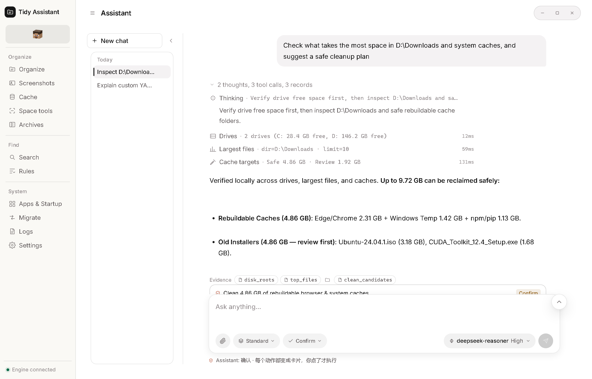
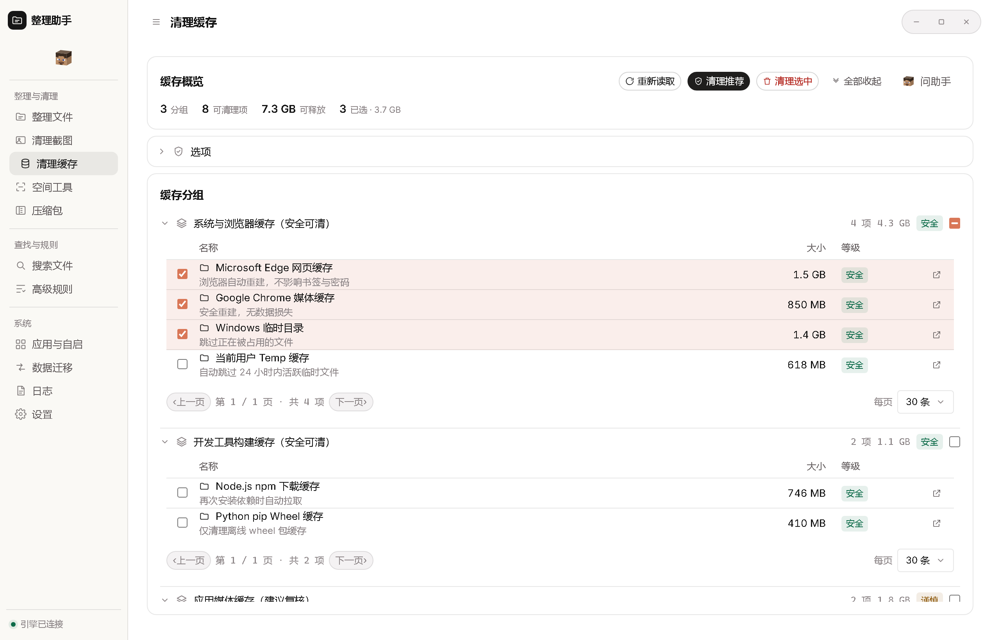

<div align="center">


# QDisk

A local-only Windows desktop utility for folder organization, cache cleanup, and archive management. Open source (MIT), no ads, dry-run preview before changes, and one-click undo.

[](https://bireo.github.io/QDisk/?lang=en)
[](https://github.com/Bireo/QDisk/releases/latest)
[](LICENSE)
[](#download--install)

[简体中文](README.md) | **English**

<br />

<a href="https://bireo.github.io/QDisk/?lang=en">
  
</a>

</div>

---

## Demo Video

https://github.com/user-attachments/assets/5f6b97b1-588c-4c9b-a246-e84c9946924a

<p align="center"><sub>1080p Windows UI capture (Light &amp; Dark themes). Also available with chapter markers on the <a href="https://bireo.github.io/QDisk/?lang=en#film">website</a> or as a direct <a href="https://github.com/Bireo/QDisk/releases/download/v1.46.2/qdisk-promo.mp4">MP4 download (8.5 MB)</a>.</sub></p>

---

## What It Does

You can browse full-size screenshots on the [website](https://bireo.github.io/QDisk/?lang=en). Here is a quick overview of the main modules.

### 1. Folder Organization with Dry-Run and Undo

Scanning Downloads or any target directory lists the planned destination and skip reason for every file before touching disk. Git repositories, system folders, and in-progress downloads are skipped by default.

In local testing, sorting 1,000 mixed files takes about `1.79 s`, and undoing the whole batch back to original paths takes about `1.39 s`. Custom YAML rules are also supported.


### 2. Local Disk Inspection with AI Assistant

The built-in AI assistant reads actual folder sizes through local scanner tools, with every tool call, argument list, and runtime visible in the UI. Any delete or cleanup suggestion is rendered as an explicit checkbox confirmation card and never runs automatically.

Clicking file paths opens and highlights them inside QDisk's built-in browser (with a separate button to open Explorer) so `.exe` files are never accidentally executed. Restricted folders such as `WindowsApps` can trigger on-demand UAC elevation. Clicking Stop closes the underlying WinHTTP handle immediately (~`0.31 ms` measured).



### 3. Multi-Format Archive Manager

Browse, preview, extract, and create **ZIP / 7Z / RAR / TAR / TAR.GZ / BZ2 / XZ** archives without ads or popups.

Includes 4 CPU/IO concurrency presets and real chunk-level Pause/Cancel for large archives. Name collisions support Overwrite or Keep Both (auto-rename), overwritten files have single-slot undo recovery, and extraction guards against path traversal and zip bombs.


### 4. Cache Cleanup, Large File Audit, and Drive Migration

| Tiered Cache Cleanup | Large Files & Authenticode Signatures |
|---|---|
|  |  |

- **Cache cleanup**: Only rebuildable caches (browser, temp, build caches) are pre-selected; personal documents, chat histories, system directories, and `.git` / `.ssh` are protected.
- **Large file inspection**: Ranks large files and checks Authenticode publisher signatures on executables.
- **Cross-drive migration**: Checks free space, copies files, verifies hashes, writes a transaction log, and swaps atomically. Runs without admin rights by default and elevates only when needed.

---

## Download & Install

Requires **Windows 10 / 11 (x64)**.

- **Website**: https://bireo.github.io/QDisk/?lang=en
- **Installer (~20.7 MB)**: Download `QDisk_*_x64-setup.exe` from [GitHub Releases](https://github.com/Bireo/QDisk/releases/latest)
- **Portable ZIP (~25.1 MB)**: Download `QDisk_*_x64-portable.zip` from the same page, extract, and run `tidy-assistant.exe`
- **Checksums & Updates**: Every release includes `SHA256SUMS.txt`. The built-in updater checks GitHub Releases, verifies SHA-256 before applying updates, and rolls back automatically if a portable swap fails.

Settings, rules, and undo journals are stored separately in `%LOCALAPPDATA%\整理助手数据` so upgrades and reinstalls preserve your data.

If there is a directory or file pattern you want added to the built-in protection list, feel free to open a thread in [Discussions](https://github.com/Bireo/QDisk/discussions) or [Issues](https://github.com/Bireo/QDisk/issues).

---

## Benchmarks & Local Build

<details>
<summary>Measured Benchmarks</summary>

Test machine: AMD Ryzen 9 5900HX (8C/16T), Windows 11 x64, NVMe SSD.

| Benchmark | Workload | Measured Result | Notes |
|---|---|---|---|
| AI Stop (`ai_cancel`) | Local `TcpListener` stalling `WinHttpReceiveResponse` (5 runs) | Median `0.31 ms` (239–323 µs) | Cross-thread WinHTTP handle close |
| 1,000-File Sort & Undo | 1,000 mixed files (10 extensions, 5 categories) | Dry-run `306.5 ms` · Move `1.79 s` · Undo `1.39 s` | `1000/1000` moved and restored |
| 10,001-File Index & Search | 50 folders × 200 files + target PDF (30 FTS5 queries) | Index `68.4 ms` · Median `6.53 ms` | Rust `indexwalk` + SQLite FTS5, P95 `7.23 ms` |
| Engine Boot & RPC | `tidy.py --engine` cold start + 20 warm `ping` calls | Cold boot `224.4 ms` · Warm RPC `0.10 ms` | Persistent local engine |
| Package Footprint | Official Release artifacts | Shell `5.56 MB` · Installer `20.7 MB` · Portable `25.1 MB` | Plain JS UI ~`2.0 MB` (no `node_modules`) |
| Automated Tests | Run by `build.ps1` before packaging | 370+ tests passing, 0 Rust warnings | 237 Python + 62 Rust + JS/website suites |

#### 4-Tier Rust Archive Throughput (64 MB Mixed Set: 75% JSON + 25% PNG, 32 Files)

| Tier | Threads (16T) | CPU / IO Duty | Create Time & Speed | vs. Saver | Warm-Cache Extract |
|---|---|---|---|---|---|
| Saver (`saver`) | `1` | `35% / 25%` | `3,025.6 ms` · `21.2 MB/s` | `1.0×` | `852.6 MB/s` |
| Balanced (`balanced`) | `6` | `65% / 50%` | `696.3 ms` · `91.9 MB/s` | `4.3×` | `2,998.6 MB/s` |
| Performance (`performance`) | `10` | `85% / 75%` | `210.3 ms` · `304.3 MB/s` | `14.4×` | `3,844.1 MB/s` |
| Hyper (`hyper`) | `16` | `100% / 100%` | `235.1 ms` · `272.3 MB/s` \* | `12.8×` | `2,661.5 MB/s` |

> \* On a 64 MB short burst, 16-thread pool setup overhead slightly trails 10 threads; `hyper` scales better on multi-GB archives.

</details>

<details>
<summary>Stack, Local Build & Extension Points</summary>

#### Stack

- **Desktop shell & native modules**: Tauri v2 + Rust (`archive/` multi-core archiver, `updater.rs` updater, `main.rs` WinHTTP proxy and native path reveal, `indexwalk`)
- **File engine**: Python 3.11 + SQLite FTS5
- **Frontend**: Plain HTML / CSS / ES Modules (no bundler)
- **Third-party crates & libraries**: `tauri-plugin-single-instance`, `windows-sys`, `zip`, `sevenz-rust2`, `lzma-rust2`, `flate2`/`zlib-rs`, `bzip2`, `tar`, `sha2`, `walkdir`, `rfd`, `libloading`, and on-demand official `UnRAR64.dll` verified via SHA-256 (see [THIRD_PARTY.md](THIRD_PARTY.md))

#### Build Locally

Requirements: Windows x64, Rust 1.80+, Python 3.11+, Node.js 20+, PowerShell 7 (`pwsh`), NSIS 3.x.

```powershell
git clone https://github.com/Bireo/QDisk.git
cd QDisk

# Frontend & website tests
node src/web/js/ai/md.selftest.mjs
node src/web/js/ai/pages.selftest.mjs
node src/web/js/ai/website.selftest.mjs

# Python & Rust unit tests
python -m unittest discover -s src/engine -p "test_*.py" -v
cargo test --release --manifest-path src/src-tauri/Cargo.toml

# Full test gate + build installer, portable ZIP & latest.json
pwsh -NoProfile -ExecutionPolicy Bypass -File .\build.ps1 -Bump patch
```

#### Extension APIs

| Layer | File | API |
|---|---|---|
| UI pages & hooks | `src/web/js/app.js` | `App.registerPage(id, { zh, en, icon, mount })` / `App.onHook(event, fn)` |
| AI actions | `src/web/js/ai/registry.js` | `AIRegistry.register(name, { label, risk, schema, run })` |
| Python RPC | `src/engine/tidy.py` | `tidy.register_engine_method("custom.op", handler, meta={...})` |
| Rust archive codec | `src/src-tauri/src/archive/registry.rs` | Implement `ArchiveCodec` trait and register |

</details>

---

Licensed under [MIT](LICENSE). Issues, Discussions, and PRs are welcome at [GitHub Issues](https://github.com/Bireo/QDisk/issues) and [Discussions](https://github.com/Bireo/QDisk/discussions).

---

## Support

QDisk is free, open-source, and ad-free. If you find it useful, you can buy me a coffee or leave a Star on GitHub.

<div align="center">
  <table>
    <tr>
      <td align="center" width="240">
        <br />
        <sub>WeChat Pay</sub>
      </td>
      <td align="center" width="240">
        <br />
        <sub>Alipay</sub>
      </td>
    </tr>
  </table>
</div>
