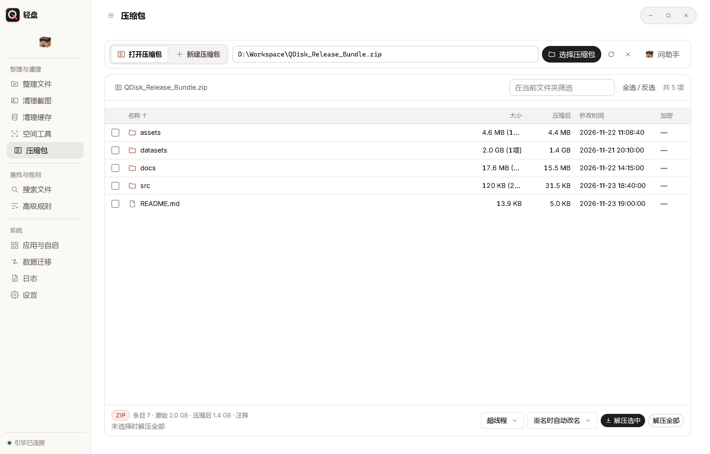

<div align="center">


# QDisk · 轻盘

**A local-first, zero-ad Windows desktop suite for safe file organization, multi-core archiving, disk cleanup, and an auditable AI assistant — with Dry-Run & one-click Undo on every risky step.**

[](https://3347567186.github.io/TidyAssistant/?lang=en)
[-161614?style=for-the-badge)](https://github.com/3347567186/TidyAssistant/releases/download/v1.43.16/QDisk_1.43.16_x64-setup.exe)
[-0969da?style=for-the-badge)](https://github.com/3347567186/TidyAssistant/releases/download/v1.43.16/QDisk_1.43.16_x64-portable.zip)

[](https://github.com/3347567186/TidyAssistant/releases/latest)
[](LICENSE)
[](#4-download-installation--deployment)
[](#1-measured-benchmarks-no-fluff)

[简体中文](README.md) | **English**

**[🌐 Visit Official Website](https://3347567186.github.io/TidyAssistant/?lang=en)** · **[⬇️ Installer (.exe)](https://github.com/3347567186/TidyAssistant/releases/download/v1.43.16/QDisk_1.43.16_x64-setup.exe)** · **[📦 Portable (.zip)](https://github.com/3347567186/TidyAssistant/releases/download/v1.43.16/QDisk_1.43.16_x64-portable.zip)** · **[📋 All Releases](https://github.com/3347567186/TidyAssistant/releases/latest)**

</div>

---

## 1. Measured Benchmarks (No Fluff)

> **Test Machine**: AMD Ryzen 9 5900HX (8C/16T) · Windows 11 x64 · NVMe SSD · QDisk. All numbers measured directly from running binaries.

### Core Latency, Footprint & Quality Gate

| Benchmark | Workload / Conditions | Measured Result | Notes |
|---|---|---|---|
| **AI Stop Socket Abort** (`ai_cancel`) | Local `TcpListener` stalling `WinHttpReceiveResponse` (5 trials) | **Median `0.31 ms`** (239–323 µs) | Cross-thread WinHTTP handle close vs. 60–300 s hangs |
| **1,000-File Organize & Full Undo** | 1,000 mixed Downloads files (10 extensions, 5 categories) | Dry-Run **`306.5 ms`** · Move **`1.79 s`** · Undo **`1.39 s`** | `1000/1000` moved, `1000/1000` restored cleanly (`0` failures) |
| **10,001-File Index & FTS5 Search** | 50 folders × 200 files + needle PDF (30 queries) | Index **`68.4 ms`** (~146k files/s) · Median **`6.53 ms`** | Rust `indexwalk` + SQLite FTS5; P95 query `7.23 ms` |
| **Engine Cold Boot & RPC Roundtrip** | `tidy.py --engine` cold start + 20 warm `ping` calls | Cold boot **`224.4 ms`** · Warm RPC **`0.10 ms`** | Persistent local engine |
| **Binary & Package Footprint** | `v1.43.16` Release artifacts | Shell exe **`5.56 MB`** · Installer **`20.6 MB`** · Portable **`25.0 MB`** | Zero-framework frontend is `2.03 MB` total (`0` `node_modules`) |
| **Automated Release Gate** | Enforced by `build.ps1` on every release | **364+ tests passing** · **`0` Rust warnings** | 234 Python + 58 Rust + 7 JS suites (72 AI golden, 35 path hygiene, 12-page 0-leak) |

### 4-Tier Adaptive Rust Archive Throughput (64 MB Mixed Set: 75% JSON + 25% PNG, 32 Files)

| Performance Tier | Threads (on 16T CPU) | CPU / I/O Duty | Create Time & Speed | Speedup vs. Saver | Warm-Cache Extract |
|---|---|---|---|---|---|
| **Saver** (`saver`) | `1` thread | `35% / 25%` | `3,025.6 ms` · **`21.2 MB/s`** | `1.0×` | `852.6 MB/s` |
| **Balanced** (`balanced`) | `6` threads | `65% / 50%` | `696.3 ms` · **`91.9 MB/s`** | **`4.3×`** | `2,998.6 MB/s` |
| **Performance** (`performance`) | `10` threads | `85% / 75%` | `210.3 ms` · **`304.3 MB/s`** | **`14.4×`** | **`3,844.1 MB/s`** |
| **Hyper** (`hyper`) | `16` threads | `100% / 100%` | `235.1 ms` · **`272.3 MB/s`** \* | **`12.8×`** | `2,661.5 MB/s` |

> \* On a short 64 MB burst, 16-thread pool init slightly trails 10 threads; on multi-GB archives `hyper` saturates all cores unthrottled.

---

## 2. Four Core Highlights

> Explore interactive runtime previews on the **[Official Website](https://3347567186.github.io/TidyAssistant/?lang=en)**.

### 1. Auditable Local-First AI Assistant (`0.31 ms` Real Stop + Approval Gate)


- **Transparent Process Rows**: Expand every turn to inspect raw reasoning, local tools called, arguments, and exact millisecond latency, with anti-hallucination checks and dual-layer glued-CJK path splitting so local links never fail with missing targets.
- **4-Tier Permissions**: `Read-only` / `Confirm` (approval cards required for every write) / `Auto` (3s undo window) / `Full Auto` (permanent deletes still require typing a confirmation word).
- **True `0.31 ms` Stop**: Cross-thread closes in-flight WinHTTP request handles in Rust and aborts JS 429/5xx retry backoffs immediately.

### 2. Dry-Run File Organizer + Lossless `1.39 s` One-Click Undo


- Always previews categories and skipped items before moving a byte; automatically protects source-code repos, system folders, and active downloads.
- Supports custom YAML rules (with direct AI draft import) and restores all `1,000` moved files in `1.39 s`.

### 3. Multi-Core Ad-Free Rust Archive Kernel (7 Formats + Pause/Cancel/Undo)



- Handles **ZIP / 7Z / RAR / TAR / TAR.GZ / BZ2 / XZ** browsing, built-in preview, extraction, and creation with CPU-scaled 4-tier pacing, real chunk-level Pause/Cancel, `Overwrite` vs. `Keep Both (Auto-Rename)` conflict prompts, single-slot atomic Undo, and hard ZIP Slip / symlink / 32 GiB zip-bomb protection.

### 4. Risk-Tiered Cache Cleaner, Signature Inspector & Transactional Migration

| Safe vs. Caution Cache Cleanup | Large Files + Authenticode Publisher Audit |
|---|---|
|  |  |

- Rebuildable caches are clearly separated from cautious items so personal chats and docs are untouched; large files expose digital signatures & publisher names; cross-drive migration verifies hashes with transaction journals and requests UAC elevation strictly on demand.

---

## 3. Built In-House vs. Open-Source Stack

| Category | Components |
|---|---|
| **Built In-House** | **Rust Multi-Core Archive Kernel** (`archive/`: 4-tier `WorkPacer`, chunk pause/cancel, traversal guards, single-slot Undo, `ArchiveCodec` registry); **Zero-Extra-Dep Updater** (`updater.rs`: Installer/Portable dual mode, repo-scoped URL lock, auto-rollback launcher); **`0.31 ms` Abortable WinHTTP AI Gateway** (`main.rs`); **Local AI Agent & Approval Gate** (`web/js/ai/`); **Zero-Framework 12-Page Desktop UI**; **Transactional Python Engine + Rust `indexwalk`** |
| **Open-Source** | **Tauri v2** & `tauri-plugin-single-instance`, **Rust Crates** (`windows-sys`, `zip`, `sevenz-rust2`, `lzma-rust2`, `flate2`/`zlib-rs`, `bzip2`, `tar`, `sha2`, `walkdir`, `rfd`, `libloading`), **Python 3.11 + SQLite FTS5**, and on-demand official `UnRAR64.dll` with double SHA-256 verification (see [THIRD_PARTY.md](THIRD_PARTY.md)) |

---

## 4. Download, Installation & Deployment

- **🌐 Official Website**: https://3347567186.github.io/TidyAssistant/?lang=en
- **⬇️ NSIS Installer (Recommended, 20.6 MB)**: [QDisk_1.43.16_x64-setup.exe](https://github.com/3347567186/TidyAssistant/releases/download/v1.43.16/QDisk_1.43.16_x64-setup.exe)
- **📦 Portable ZIP (Zero-Install, 25.0 MB)**: [QDisk_1.43.16_x64-portable.zip](https://github.com/3347567186/TidyAssistant/releases/download/v1.43.16/QDisk_1.43.16_x64-portable.zip) (extract to an ASCII path and run `tidy-assistant.exe`)
- **🔐 Checksums & Releases**: [GitHub Releases](https://github.com/3347567186/TidyAssistant/releases/latest) · [SHA256SUMS.txt](https://github.com/3347567186/TidyAssistant/releases/download/v1.43.16/SHA256SUMS.txt)

> Requires **Windows 10 / 11 (x64)**. User configs, rules, and undo journals stay safely isolated in `%LOCALAPPDATA%\整理助手数据`. Zero-config in-app updates verify SHA-256 automatically (with auto-rollback for Portable mode).

---

## 5. Secondary Development & 4 Built-In Extension APIs

Requires Windows x64 + Rust 1.80+ + Python 3.11+ + Node.js 20+ + PowerShell 7 (`pwsh`) + NSIS 3.x:

```powershell
git clone https://github.com/3347567186/TidyAssistant.git && cd TidyAssistant

# Run offline frontend selftests (~3s, zero bundler)
node src/web/js/ai/scope.selftest.mjs
node src/web/js/ai/agent.selftest.mjs
node src/web/js/ai/pages.selftest.mjs

# Run Python engine tests (234) & Rust unit tests (58)
python -m unittest discover -s src/engine/tests -v
cargo test --release --manifest-path src/src-tauri/Cargo.toml

# Run full test gate + build Installer, Portable ZIP & latest.json
pwsh -NoProfile -ExecutionPolicy Bypass -File .\build.ps1 -Bump patch
```

| Layer | File | Extension API |
|---|---|---|
| **UI Pages & Hooks** | `src/web/js/app.js` | `App.registerPage(id, { zh, en, icon, mount })` / `App.onHook(event, fn)` |
| **AI Actions** | `src/web/js/ai/registry.js` | `AIRegistry.register(name, { label, risk, schema, run })` (auto-wired to approval gate) |
| **Python RPC** | `src/engine/tidy.py` | `tidy.register_engine_method("custom.op", handler, meta={...})` |
| **Rust Archive Codec** | `src/src-tauri/src/archive/registry.rs` | Implement `ArchiveCodec` trait; auto-exposed via `archive_capabilities` |

---

Issues & PRs welcome at [GitHub Issues](https://github.com/3347567186/TidyAssistant/issues) · Licensed under **[MIT](LICENSE)**.
