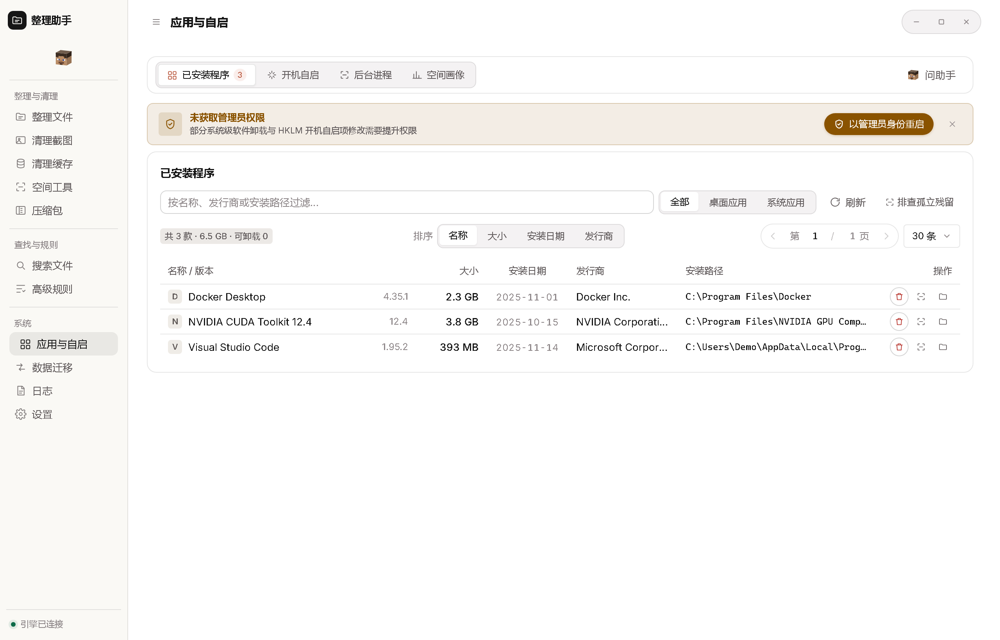
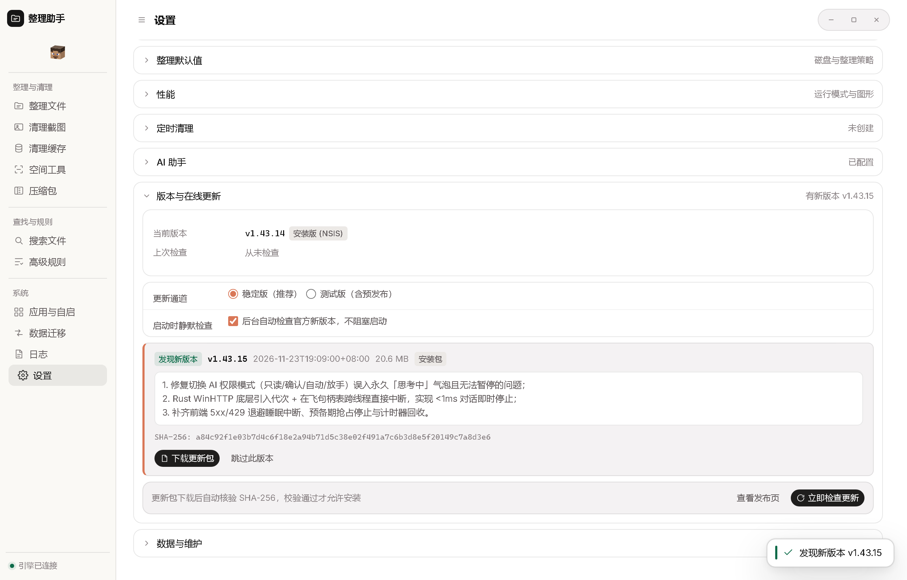
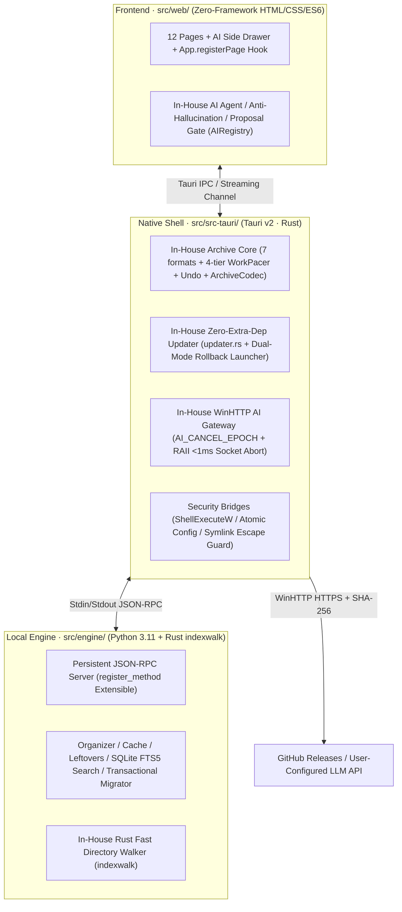

<div align="center">

# TidyAssistant

**A local-first, ad-free Windows desktop utility for safe file organization, high-speed archive management, disk maintenance, and an auditable AI assistant — with Dry-Run preview & one-click Undo on every risky action.**

[](https://github.com/3347567186/TidyAssistant/releases/latest)
[](LICENSE)
[](#4-installation--deployment)
[](#3-architecture-what-we-built-vs-open-source-stack)
[](#5-secondary-development--customization)

[简体中文](README.md) | **English**

[Features & Screenshots](#2-feature-tour--runtime-screenshots) · [Architecture & Stack](#3-architecture-what-we-built-vs-open-source-stack) · [Install & Deploy](#4-installation--deployment) · [Secondary Development](#5-secondary-development--customization) · [Security](#6-security--privacy-guarantees)

</div>

---

## 1. Why TidyAssistant?

Most Windows cleaners and archive utilities are bloated with pop-up ads, opaque deletions, or frozen progress dialogs that ignore Pause/Cancel. Meanwhile, giving a generic AI agent blind shell access to your hard drive is a recipe for hallucinated deletions.

**TidyAssistant** combines a **Tauri v2 (Rust)** native shell, a local **Python + Rust** engine, and a **zero-framework Vanilla JS** frontend to unify **12 daily file & system workflows** in one clean, auditable, reversible desktop app:

- **Messy Downloads folder**: Scan & preview first → classify by content/extension/custom YAML rules → automatically skip system files & active `.crdownload` downloads → **one-click Undo** restores every moved file cleanly.
- **Full C: drive without fear**: Rebuildable caches are clearly separated from cautious items; large files show digital signatures & publisher metadata; cross-drive migration uses hash verification, resume support, and **full-transaction rollback**.
- **Ad-free, responsive archiving**: Native Rust multi-core engine supporting **7 archive formats**, 4 adaptive CPU performance tiers, real millisecond Pause/Cancel, overwrite/coexist conflict prompts, and single-slot atomic Undo.
- **Auditable local-first AI assistant**: Bring your own OpenAI-compatible API key or local Ollama endpoint. Every answer is grounded in real local tool output with anti-hallucination size/path verification, **every write/delete action requires an approval card**, and **Stop aborts WinHTTP sockets in `<1 ms`**.

---

## 2. Feature Tour & Runtime Screenshots

> All screenshots below are real runtime captures of the actual application UI (with sanitized demo paths). Full bilingual **English (`en-US`)** and **Simplified Chinese (`zh-CN`)** UI switching is built in.

### 1. Local-First Auditable AI Assistant (English & Chinese UI)


<details>
<summary>View Chinese UI Screenshot / 查看中文界面截图</summary>


</details>

- **Transparent Process Rows**: Collapses to `2 thoughts, 3 tool calls, 3 records` and expands on click to show exact reasoning text, local tools called, parameters, and latency (`12ms / 59ms / 131ms`).
- **Anti-Hallucination Verification**: Sizes and paths cited in answers are cross-checked against actual tool results; fabricated numbers or mismatched drive letters trigger automatic repair or explicit warnings.
- **4-Tier Action Permissions**: `Read-only` (write tools removed) / `Confirm` (every write becomes a reviewable approval card) / `Auto` (reversible actions run with a 3-second stop window) / `Full Auto` (recycle-bin actions auto-run; permanent deletions still require typing a confirmation word).
- **Multi-Endpoint Failover & `<1 ms` Real Stop**: Works with DeepSeek, OpenAI, Kimi, Zhipu, Qwen, local Ollama, and automatic fallback endpoints. Clicking **Stop** cancels JS retries/promises in 0 ms and cross-thread closes in-flight WinHTTP handles in Rust (`<1 ms`) so no extra tokens are wasted.

---

### 2. Smart File Organizer (Dry-Run Preview + YAML Rules + One-Click Undo)


- **Dry-Run First**: Shows total files, size, category groups, and skipped reasons before moving a single byte.
- **Presets & Custom YAML Rules**: Switch between `Standard / All files / Cautious`, or customize rules via the visual Rules editor (with one-click YAML draft import from the AI Assistant).
- **Full Reversibility**: Every organize run writes an operation manifest so one click restores original paths.

---

### 3. High-Speed Ad-Free Archive Manager (7 Formats + 4-Tier Performance + Pause/Cancel/Undo)


- **7 Supported Formats**: Browse, filter, preview (text, code, images, PDF, audio/video, hex), extract, and create **ZIP / 7Z / RAR / TAR / TAR.GZ / BZ2 / XZ** archives with password support.
- **4 Adaptive Performance Tiers**: `Saver` / `Balanced` / `High` / `Hyper` — dynamically scaled to your host CPU core count (`WorkPacer`), with full-core parallel chunking in `Hyper` mode.
- **Real Pause, Resume & Instant Cancel**: Chunk-level cooperative pause/cancel with persistent progress button DOM references (never drops clicks during high-frequency IPC updates).
- **Conflict Resolution & Atomic Undo**: Prompts `Overwrite` vs `Keep Both (Auto-Rename)` on name collisions and offers single-slot safe Undo that restores overwritten files without disk bloat.

---

### 4. Risk-Tiered Cache Cleaner & Screenshot Maintenance


- **Clear Risk Tiers**: Separates `Safe` (browser, Windows temp, npm/pip build caches that rebuild automatically) from `Caution` (GPU shader caches, historical extensions).
- **Hardcoded Safety Gates**: Drive roots, `Windows`, `Program Files`, `.git`, `.ssh`, NTFS Alternate Data Streams, and symlink escapes are blocked at the native layer.
- **Scheduled Maintenance**: Optional scheduled cleanup for safe caches and expired screenshots.

---

### 5. Space Tools: Largest Files, Digital Signature Inspector, Empty Folders & Fast Search


- **Time-Budgeted Scanning**: Powered by a custom Rust walker (`indexwalk`) so scanning large drives never freezes the UI.
- **Signature & Publisher Signals**: Inspects Authenticode signature status, publisher name, and staleness to distinguish old installers from active runtime binaries.
- **Empty Folder Sweeper & SQLite FTS5 Search**: Automatically protects symlinks/junctions and app-owned empty directories; full-disk indexed search answers in milliseconds.

---

### 6. Apps, Startup Manager & Transactional Cross-Drive Migration



- **Apps, Startup, Processes & Storage Footprint**: Manage desktop & Microsoft Store apps, inspect startup entries, detect orphaned leftovers, and elevate via UAC strictly on demand.
- **Transactional Cross-Drive Migration**: Dry-run space check → copy → hash verification → transaction journal → atomic switch, supporting interruption resume and full-task rollback.

---

### 7. Zero-Config Built-In Online Updater (Installer & Portable Dual-Mode)



- **Zero URL Configuration**: Pre-wired to official GitHub Releases with `Stable` / `Beta` channel selection and silent background check (6 seconds after startup, zero noise when offline).
- **End-to-End Integrity & Auto-Rollback**: Enforces HTTPS + repository-path allowlist + 64-char SHA-256 verification + PE/ZIP header validation. Automatically detects **NSIS Installer** vs **Portable ZIP** mode; Portable updates stage, verify both binaries, back up the previous version, atomically swap, and **auto-rollback on failure** while preserving `%LOCALAPPDATA%\整理助手数据`.

---

## 3. Architecture: What We Built vs. Open-Source Stack

### Three-Layer Architecture



### 1. What We Built In-House

| Component | Location | Key Engineering Highlights |
|---|---|---|
| **Multi-Core Archive Kernel** | `src/src-tauri/src/archive/` | Adaptive CPU-scaled `WorkPacer` (4 tiers), parallel chunk compression, real pause/resume/cancel state machine, ZIP Slip / symlink / 32 GiB zip-bomb hard guards, conflict detection, single-slot atomic Undo, and extensible `ArchiveCodec` registry. |
| **Dual-Mode Native Updater** | `src/src-tauri/src/updater.rs` | Zero extra Cargo dependencies (reuses WinHTTP + `sha2`); supports both Tauri `latest.json` and GitHub Releases API, repo-scoped URL allowlist, manual per-hop redirect anti-downgrade/anti-SSRF checks, pre-install TOCTOU re-hash, and self-healing rollback launcher for Portable builds. |
| **`<1 ms` Abortable WinHTTP AI Gateway** | `src/src-tauri/src/main.rs` | Monotonic `AI_CANCEL_EPOCH` + `ACTIVE_AI_HANDLES` table + `AiRequestGuard` RAII wrapper that cross-thread closes active `HINTERNET` request handles outside the lock — eliminating 60–300s WinHTTP stop hangs with mathematically guaranteed exactly-once handle closure. |
| **Local-First AI Agent & Approval Gate** | `src/web/js/ai/` | Native Function Calling ↔ JSON protocol auto-fallback, abortable 429/5xx backoff sleep, multi-endpoint failover with checkpoint resume, tool-sourced size/path anti-hallucination checks, 4-tier permission policies (`proposals.js`), and NTFS/ADS/reserved-name guards (`guard.js`). |
| **Zero-Framework Desktop UI Engine** | `src/web/js/` | Zero bundler, zero virtual-DOM overhead, instant boot; navigation unmount race protection, persistent progress DOM updates, built-in ZH/EN i18n, Light/Dark themes, and full offline DOM selftest harness. |
| **Transactional Engine & Rust Walker** | `src/engine/` | Persistent JSON-RPC dispatcher, dry-run/undo file organizer, hash-verified resumable cross-drive migrator, SQLite FTS5 indexer, and native Rust directory walker `indexwalk`. |
| **Automated Quality & Release Gate** | `build.ps1`, `tools/publish-release.ps1` | Runs 4 Python suites (234 tests) + 7 JS selftests (72 AI golden cases + 12-page leak/UI regressions) + 56 Rust unit tests (including real local TCP socket abort & HTTP updater E2E tests) + 0-warning Release build + `latest.json` / `SHA256SUMS.txt`. |

### 2. Open-Source Libraries & Third-Party Components Used

> Full license texts and notices are documented in [THIRD_PARTY.md](THIRD_PARTY.md).

| Layer | Library / Tool | Version | License | Role |
|---|---|---|---|---|
| **App Shell** | [Tauri](https://tauri.app/) & `tauri-plugin-single-instance` | v2 | MIT / Apache-2.0 | Native Windows WebView2 shell, system tray, single-instance lock, IPC |
| **Win32 & Core** | `windows-sys`, `rfd`, `serde`, `serde_json`, `anyhow` | 0.61 / 0.15 / 1.x | MIT / Apache-2.0 | WinHTTP, `ShellExecuteW`, thread priority, native file dialogs, JSON |
| **Archive Codecs** | `zip`, `sevenz-rust2`, `lzma-rust2`, `flate2` (`zlib-rs`), `bzip2`, `tar`, `walkdir` | See [Cargo.toml](src/src-tauri/Cargo.toml) | MIT / Apache-2.0 / Zlib / BSD | Statically linked ZIP / 7Z / LZMA2 / Deflate / Bzip2 / XZ / TAR codecs |
| **Crypto & FFI** | `sha2`, `libloading` | 0.10 / 0.8 | MIT / Apache-2.0 / ISC | SHA-256 integrity checks & dynamic loading of optional `UnRAR64.dll` |
| **RAR Read (On-Demand)** | RARLAB `UnRAR64.dll` (not bundled) | 7.10 x64 | Freeware | Downloaded from official RARLAB URL on first RAR open with double SHA-256 verification |
| **Local Engine** | Python 3.11 (`sqlite3` FTS5 / `hashlib`) + PyYAML + PyInstaller | 3.11 | PSF / MIT | Rule evaluation, cache/leftover analysis, FTS5 search, standalone engine binary |
| **UI Reference** | `dsh-claude-style` (visual layout reference only; code written from scratch) | v0.19.5 | MIT | Process-row visual proportion reference for `procs.js` |

---

## 4. Installation & Deployment

### Option A: End-User Quick Install (30 Seconds)

Download from the **[Latest GitHub Release](https://github.com/3347567186/TidyAssistant/releases/latest)**:

| Distribution | Asset Name | Best For | Online Updates |
|---|---|---|---|
| **NSIS Installer (Recommended)** | `TidyAssistant_x.y.z_x64-setup.exe` | Daily desktop usage with Start Menu shortcuts & clean uninstall | One-click check, SHA-256 verify, and upgrade inside Settings |
| **Portable ZIP** | `TidyAssistant_x.y.z_x64-portable.zip` | Zero-install / USB drive usage — extract to an ASCII path (e.g. `D:\Apps\TidyAssistant`) and run `tidy-assistant.exe` | One-click download, verify, atomic swap with automatic rollback on failure |

- **Requirements**: Windows 10 / 11 (x64) with Microsoft Edge WebView2 Runtime (pre-installed on Windows 11).
- **Data Persistence**: All configs, rules, undo history, and AI chats live under `%LOCALAPPDATA%\整理助手数据` — preserved across upgrades and reinstalls.

### Option B: Private Mirror / Self-Hosted Update Deployment

```powershell
# 1. Build installer + portable ZIP + manifests
pwsh -NoProfile -ExecutionPolicy Bypass -File .\build.ps1

# 2. Generate latest.json & SHA256SUMS.txt pointing to your static CDN / OSS / Nginx mirror
pwsh -NoProfile -ExecutionPolicy Bypass -File .\tools\publish-release.ps1 `
  -BaseUrl "https://downloads.example.com/tidyassistant/"

# 3. Local 10-second end-to-end updater test server (loopback only)
pwsh -NoProfile -ExecutionPolicy Bypass -File .\tools\publish-release.ps1 -ServeLocal -Port 18765
# Launch the app with TIDY_UPDATE_FEED="http://127.0.0.1:18765/latest.json" to verify the full flow
```

A ready-to-use GitHub Actions workflow is included at [`.github/workflows/release.yml`](.github/workflows/release.yml).

---

## 5. Secondary Development & Customization

### 1. Prerequisites (Windows x64)

- **Rust & Cargo** (`1.80+`, MSVC or MinGW GNU target)
- **Python 3.11+** (`pip install pyyaml pyinstaller`)
- **Node.js 20+** (22 LTS recommended — only used to run offline JS selftests; frontend needs **zero** build step)
- **PowerShell 7 (`pwsh`)** & **NSIS 3.x** (for packaging `x64-setup.exe`)

### 2. Project Layout

```text
TidyAssistant/
├── build.ps1                      # Full test gate + Rust/Python builds + NSIS/Portable packaging
├── tools/publish-release.ps1      # Manifest generator & one-click GitHub Release publisher
├── src/
│   ├── src-tauri/src/             # Rust shell (main.rs, updater.rs, archive/*)
│   ├── engine/                    # Python JSON-RPC engine, tests/, and Rust indexwalk/
│   └── web/                       # Zero-framework frontend (index.html, styles.css, js/pages/*, js/ai/*)
└── docs/assets/screenshots/       # Runtime UI screenshots
```

### 3. Local Dev & Test Commands

```powershell
git clone https://github.com/3347567186/TidyAssistant.git
cd TidyAssistant

# Run frontend offline selftests (zero bundler, ~3s)
node src/web/js/ai/scope.selftest.mjs
node src/web/js/ai/agent.selftest.mjs
node src/web/js/ai/pages.selftest.mjs

# Run Python engine tests (234 tests)
python -m unittest discover -s src/engine/tests -v

# Run Rust unit tests (56 tests, including real WinHTTP socket abort & updater E2E)
cargo test --release --manifest-path src/src-tauri/Cargo.toml

# Run full test gate, bump patch version, and build release artifacts
pwsh -NoProfile -ExecutionPolicy Bypass -File .\build.ps1 -Bump patch
```

### 4. Four Built-In Extension Points

1. **Register a Custom UI Page & Lifecycle Hooks** (`src/web/js/app.js`):
   ```js
   window.App.registerPage('custom-tool', {
     zh: '自定义工具',
     en: 'Custom Tool',
     icon: 'spark',
     mount(root) {
       root.innerHTML = '<div class="card"><h2>Hello Extension</h2></div>';
       return () => { /* cleanup on unmount */ };
     }
   });
   window.App.onHook('updater:available', (info) => console.log(info.latestVersion));
   ```
2. **Register a Gated AI Assistant Action** (`src/web/js/ai/registry.js`):
   ```js
   window.AIRegistry.register('custom_audit', {
     label: 'Custom Audit',
     risk: 'readonly', // readonly | reversible | destructive
     schema: { type: 'object', properties: { dir: { type: 'string' } }, required: ['dir'] },
     async run(args) { return { ok: true, summary: `Audited ${args.dir}` }; }
   });
   ```
3. **Register a Python JSON-RPC Engine Method** (`src/engine/rpc.py`):
   ```python
   from rpc import register_method

   @register_method("custom.ping")
   def handle_custom_ping(params: dict) -> dict:
       return {"ok": True, "echo": params.get("msg", "")}
   ```
4. **Register a New Rust Archive Codec** (`src/src-tauri/src/archive/registry.rs`):
   Implement the `ArchiveCodec` trait and register it in `ArchiveRegistry` — capabilities are automatically exposed via `app_capabilities` / `archive_capabilities`.

---

## 6. Security & Privacy Guarantees

1. **Dry-Run by Default**: Destructive or bulk file actions always preview first and require confirmation.
2. **Defense-in-Depth Guards**: System folders, drive roots, `.git`/`.ssh`, NTFS ADS, reserved Windows device names, symlink/junction traversal, and 32 GiB / 500k-entry zip bombs are blocked at the native layer.
3. **Zero Telemetry, Zero Ads**: No background phone-home. Network access happens solely for official update checks, optional official UnRAR download, or your own configured AI API endpoint.

---

## 7. Contributing & License

Issues and Pull Requests are very welcome at [GitHub Issues](https://github.com/3347567186/TidyAssistant/issues).  
Licensed under the **[MIT License](LICENSE)**.
