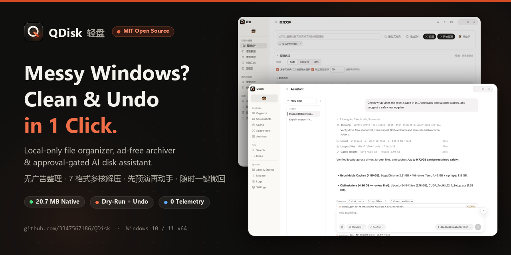
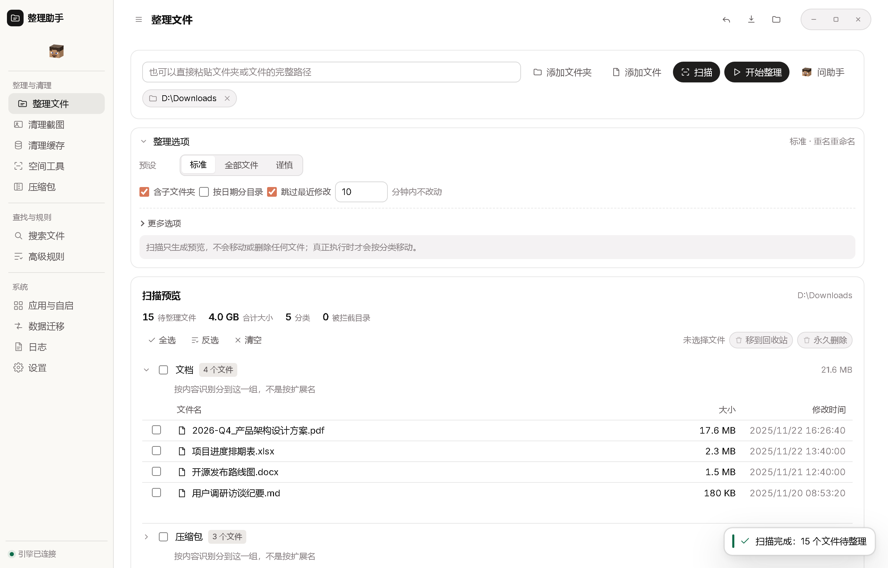
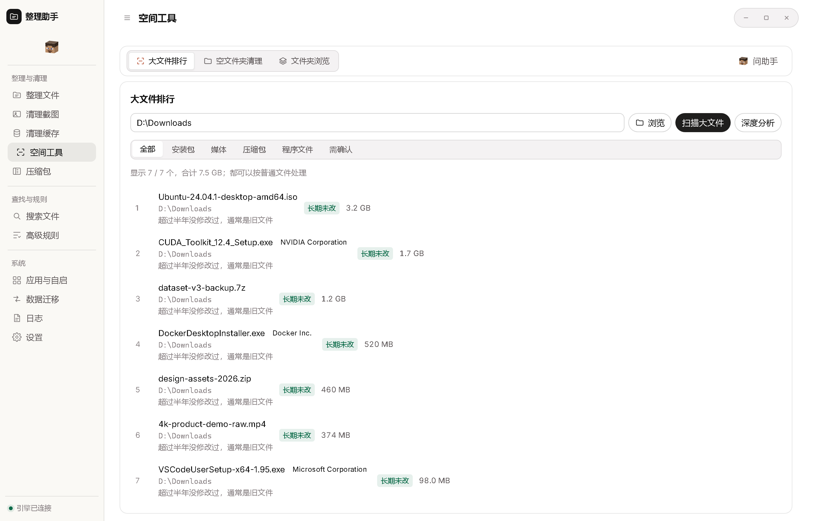

<div align="center">


# QDisk · 轻盘

**Tired of a messy Downloads folder, a red `C:` drive you're afraid to clean, and ad-filled archivers?**  
**I built a 20.7 MB, local-only, open-source Windows tool that previews every risky change first — and undoes 1,000 moved files in 1.4 seconds.**

[](https://3347567186.github.io/QDisk/?lang=en)
[-161614?style=for-the-badge)](https://github.com/3347567186/QDisk/releases/latest)
[](https://github.com/3347567186/QDisk/discussions)

[](https://github.com/3347567186/QDisk/releases/latest)
[](https://github.com/3347567186/QDisk/stargazers)
[](LICENSE)
[](#3-download--get-started-in-30-seconds)

[简体中文](README.md) | **English**

<br />

<a href="https://3347567186.github.io/QDisk/?lang=en">
  
</a>

</div>

---

## 1. Four Everyday Windows Headaches QDisk Solves

> Short 10-second demo GIFs are on the way; explore interactive previews right now on the **[Official Website](https://3347567186.github.io/QDisk/?lang=en)** or inspect the live UI screenshots below.

### 1. Hundreds of cluttered files in Downloads — tidy in 2 seconds, undo everything in 1.39 seconds

- **Dry-Run first, always**: Scanning previews exact target folders and skip reasons before a single byte moves — automatically protecting code repositories, system folders, and active downloads.
- **Zero regret**: Organizes `1,000` mixed files in `1.79 s`, and restores every single one back to its original path in `1.39 s` with one click. Supports custom YAML rules (with AI draft generation).



### 2. Your `C:` drive is red, but you're scared to delete the wrong thing — ask an approval-gated local AI

- **Verified locally, never acts behind your back**: Ask *"What's eating space on my C: drive and Downloads?"* — QDisk runs real local scanners, shows every tool call and millisecond latency transparently, and turns every delete/clean action into a **checkbox approval card** you must explicitly confirm.
- **Safe in-app navigation (never blindly runs `.exe` files)**: Clicking any path opens and highlights it right inside QDisk's built-in file browser (with an explicit Explorer button beside it); restricted folders like `WindowsApps` offer one-click UAC relaunch to resume locating; pressing Stop aborts stalled API sockets in `0.31 ms`.


### 3. Fed up with ad-ridden archivers that freeze mid-extract — 7 formats, multi-core speed & real Pause

- Browse, preview, extract, and create **ZIP / 7Z / RAR / TAR / TAR.GZ / BZ2 / XZ** with zero ads or nags.
- **4-tier CPU pacing & real chunk-level Pause/Cancel**: Choose `Overwrite` or `Keep Both (Auto-Rename)` on name conflicts, recover overwritten files via built-in single-slot Undo, and block ZIP Slip, symlink escapes, and 32 GiB zip bombs.


### 4. Reclaim tens of GB safely — tiered cache cleanup, signature audit & transactional drive migration

| Safe vs. Caution Cache Cleanup (never touches personal docs) | Large Files + Authenticode Publisher Inspection |
|---|---|
|  |  |

- **Only rebuildable caches are auto-checked** (browser, temp, build caches); hard guards protect system folders, `.git` / `.ssh`, and personal documents.
- **Crash-safe cross-drive migration**: Free-space precheck → copy → hash verification → transaction journal → atomic swap, running unprivileged by default and requesting UAC strictly on demand.

---

## 2. How QDisk Compares

| Dimension | Ad-Supported Cleaners / Archivers | DIY Scripts / Separate Tools | QDisk |
|---|---|---|---|
| **Ads, Popups & Telemetry** | Frequent nags, upsells, or telemetry | Clean, but steep setup | **Zero ads, zero telemetry, 100% local data** |
| **Mistake Recovery** | Rarely reversible once cleaned | One typo can be permanent | **Dry-Run preview + 1-click Undo on risky actions** |
| **Large Archive Handling** | Often no true pause; overwrite risk | No GUI preview or conflict prompt | **7 formats, 4-tier pacing, real Pause & Keep Both** |
| **AI Disk Triage Safety** | None or unchecked scripts | Manual inspection is slow | **Tool-verified + approval cards + safe in-app locate** |
| **Footprint & Portability** | 150 MB+ installers & background services | Scattered across 5+ apps | **20.7 MB installer / Portable ZIP / MIT Open Source** |

---

## 3. Download & Get Started in 30 Seconds

- **🌐 Official Website**: https://3347567186.github.io/QDisk/?lang=en
- **⬇️ NSIS Installer (Recommended, ~20.7 MB)**: Grab `QDisk_*_x64-setup.exe` from **[Latest GitHub Release](https://github.com/3347567186/QDisk/releases/latest)**
- **📦 Portable ZIP (~25.1 MB)**: Grab `QDisk_*_x64-portable.zip` from the same page (extract to an ASCII path and launch `tidy-assistant.exe`)
- **🔐 Verification & Updates**: Every release ships with `SHA256SUMS.txt`. The built-in updater verifies SHA-256 against official GitHub Releases automatically, with atomic rollback in Portable mode.

> Requires **Windows 10 / 11 (x64)**. Configs, custom rules, and undo journals are isolated in `%LOCALAPPDATA%\整理助手数据`.

💬 **Help shape the safety rules in [GitHub Discussions](https://github.com/3347567186/QDisk/discussions)**: What folder or file type are you most afraid a cleaner might accidentally delete? Drop a comment and I'll add it to the hard-coded protection list.

---

## 4. For Engineers & Contributors (Benchmarks, Architecture & Extensions)

<details>
<summary><strong>📊 Expand: Measured Benchmarks (No Estimates — 0.31 ms Socket Abort, 304.3 MB/s Archiving, 370+ Automated Tests)</strong></summary>

> **Test Machine**: AMD Ryzen 9 5900HX (8C/16T) · Windows 11 x64 · NVMe SSD · QDisk. All numbers measured directly from running binaries.

| Benchmark | Workload / Conditions | Measured Result | Notes |
|---|---|---|---|
| **AI Stop Socket Abort** (`ai_cancel`) | Local `TcpListener` stalling `WinHttpReceiveResponse` (5 trials) | **Median `0.31 ms`** (239–323 µs) | Cross-thread WinHTTP handle close vs. 60–300 s hangs |
| **1,000-File Organize & Full Undo** | 1,000 mixed Downloads files (10 extensions, 5 categories) | Dry-Run **`306.5 ms`** · Move **`1.79 s`** · Undo **`1.39 s`** | `1000/1000` moved and restored cleanly (`0` failures) |
| **10,001-File Index & FTS5 Search** | 50 folders × 200 files + needle PDF (30 queries) | Index **`68.4 ms`** (~146k files/s) · Median **`6.53 ms`** | Rust `indexwalk` + SQLite FTS5; P95 query `7.23 ms` |
| **Engine Cold Boot & RPC Roundtrip** | `tidy.py --engine` cold start + 20 warm `ping` calls | Cold boot **`224.4 ms`** · Warm RPC **`0.10 ms`** | Persistent local engine |
| **Binary & Package Footprint** | Official Release artifacts | Shell exe **`5.56 MB`** · Installer **`20.7 MB`** · Portable **`25.1 MB`** | Zero-framework UI is ~`2.0 MB` total (`0` `node_modules`) |
| **Automated Release Gate** | Enforced by `build.ps1` on every release | **370+ tests passing** · **`0` Rust warnings** | 237 Python + 62 Rust + 8 JS/Website automated Red-Team suites |

#### 4-Tier Adaptive Rust Archive Throughput (64 MB Mixed Set: 75% JSON + 25% PNG, 32 Files)

| Performance Tier | Threads (16T CPU) | CPU / I/O Duty | Create Time & Speed | Speedup vs. Saver | Warm-Cache Extract |
|---|---|---|---|---|---|
| **Saver** (`saver`) | `1` thread | `35% / 25%` | `3,025.6 ms` · **`21.2 MB/s`** | `1.0×` | `852.6 MB/s` |
| **Balanced** (`balanced`) | `6` threads | `65% / 50%` | `696.3 ms` · **`91.9 MB/s`** | **`4.3×`** | `2,998.6 MB/s` |
| **Performance** (`performance`) | `10` threads | `85% / 75%` | `210.3 ms` · **`304.3 MB/s`** | **`14.4×`** | **`3,844.1 MB/s`** |
| **Hyper** (`hyper`) | `16` threads | `100% / 100%` | `235.1 ms` · **`272.3 MB/s`** \* | **`12.8×`** | `2,661.5 MB/s` |

> \* On a short 64 MB burst, 16-thread pool init slightly trails 10 threads; on multi-GB archives `hyper` saturates all logical cores unthrottled.

</details>

<details>
<summary><strong>🧱 Expand: Architecture, Local Build & 4 Built-In Extension APIs</strong></summary>

#### Built In-House vs. Open-Source Stack

| Category | Components |
|---|---|
| **Built In-House** | **Rust Multi-Core Archive Kernel** (`archive/`: 4-tier `WorkPacer`, chunk pause/cancel, traversal guards, single-slot Undo, `ArchiveCodec`); **Zero-Extra-Dep Updater** (`updater.rs`: Installer/Portable dual mode, repo-scoped URL lock, auto-rollback); **`0.31 ms` Abortable WinHTTP AI Gateway & Native Path Probe** (`main.rs`); **Local AI Agent & 4-Tier Approval Gate** (`web/js/ai/`); **Zero-Framework 12-Page Desktop UI**; **Transactional Python Engine + Rust `indexwalk`** |
| **Open-Source** | **Tauri v2** & `tauri-plugin-single-instance`, **Rust Crates** (`windows-sys`, `zip`, `sevenz-rust2`, `lzma-rust2`, `flate2`/`zlib-rs`, `bzip2`, `tar`, `sha2`, `walkdir`, `rfd`, `libloading`), **Python 3.11 + SQLite FTS5**, and on-demand official `UnRAR64.dll` with double SHA-256 verification (see [THIRD_PARTY.md](THIRD_PARTY.md)) |

#### Build & Test Locally

Requires Windows x64 + Rust 1.80+ + Python 3.11+ + Node.js 20+ + PowerShell 7 (`pwsh`) + NSIS 3.x:

```powershell
git clone https://github.com/3347567186/QDisk.git && cd QDisk

# Offline frontend & website selftests (zero bundler)
node src/web/js/ai/md.selftest.mjs
node src/web/js/ai/pages.selftest.mjs
node src/web/js/ai/website.selftest.mjs

# Python engine tests (237) & Rust unit tests (62)
python -m unittest discover -s src/engine -p "test_*.py" -v
cargo test --release --manifest-path src/src-tauri/Cargo.toml

# Full test gate + build Installer, Portable ZIP & latest.json
pwsh -NoProfile -ExecutionPolicy Bypass -File .\build.ps1 -Bump patch
```

#### Four Extension APIs (No Core Edits Needed)

| Layer | File | Extension API |
|---|---|---|
| **UI Pages & Hooks** | `src/web/js/app.js` | `App.registerPage(id, { zh, en, icon, mount })` / `App.onHook(event, fn)` |
| **AI Actions** | `src/web/js/ai/registry.js` | `AIRegistry.register(name, { label, risk, schema, run })` (auto-wired to approval gate) |
| **Python RPC** | `src/engine/tidy.py` | `tidy.register_engine_method("custom.op", handler, meta={...})` |
| **Rust Archive Codec** | `src/src-tauri/src/archive/registry.rs` | Implement `ArchiveCodec` trait; auto-exposed via `archive_capabilities` |

</details>

---

Issues, Discussions & PRs welcome at [GitHub Issues](https://github.com/3347567186/QDisk/issues) · [Discussions](https://github.com/3347567186/QDisk/discussions) · Licensed under **[MIT](LICENSE)**.

---

## ☕ Buy the Author a Coffee

> Building and maintaining an indie open-source tool takes time and care. If **QDisk** has saved you time or reclaimed disk space, consider buying the author a coffee — every bit of support fuels future updates and polish. Thank you!

<div align="center">
  <table>
    <tr>
      <td align="center" width="260">
        <br />
        <sub><strong>WeChat Pay</strong></sub>
      </td>
      <td align="center" width="260">
        <br />
        <sub><strong>Alipay</strong></sub>
      </td>
    </tr>
  </table>
  <p><sub>Forever free, open-source &amp; ad-free · Giving a ⭐ Star is equally appreciated!</sub></p>
</div>
