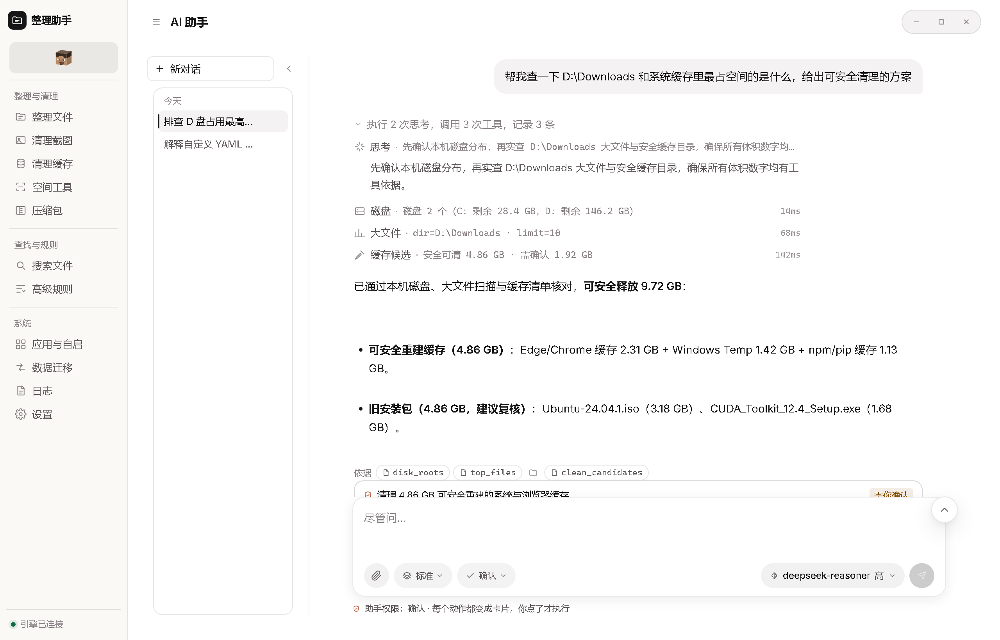
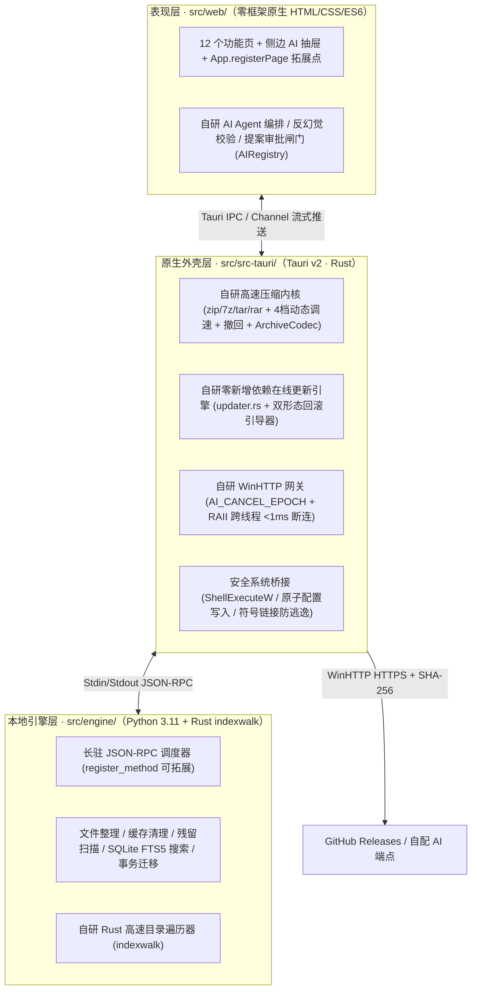

<div align="center">

# 整理助手 · TidyAssistant

**本地优先、零广告、每步高危动作均可预演与撤回的 Windows 桌面整理、高速压缩、空间维护与可审计 AI 助手**

[](https://github.com/3347567186/TidyAssistant/releases/latest)
[](LICENSE)
[](#四怎么安装与部署)
[](#三自研架构与开源技术栈)
[](#五怎么进行二次开发)

**简体中文** | [English](README.en.md)

[功能与界面图解](#二完整功能矩阵与运行时界面图解) · [自研与技术栈](#三自研架构与开源技术栈) · [安装与部署](#四怎么安装与部署) · [二次开发指南](#五怎么进行二次开发) · [安全底线](#六安全底线与隐私承诺)

</div>

---

## 一、为什么做「整理助手」？（真实痛点与核心场景）

市面上的电脑管家和解压软件，往往在「弹窗广告」「后台驻留」「黑盒乱删」「卡死停不下来」里反复横跳；而把硬盘直接交给通用 AI Agent，又让人担心模型幻觉误删重要源码或聊天记录。

**TidyAssistant（整理助手）** 采用 **Tauri v2（Rust）+ 本地 Python 引擎 + 零框架原生前端** 构建，把日常高频的 **12 项文件与系统维护能力** 收拢进一个轻量、零广告、可审计、可撤回的桌面应用里：

- **下载文件夹一团糟**：扫描预览 → 智能按内容/扩展名/自定义 YAML 规则归类 → 跳过系统文件与下载中临时文件 → 执行后不满意**一键全部撤回**。
- **C 盘爆红又不敢乱删**：缓存分层标注「安全/谨慎」；大文件带数字签名与厂商识别；跨盘数据迁移带哈希校验、断点续跑与**整任务一键回滚**。
- **解压软件弹广告、大包暂停失效**：内置 Rust 并发多核压缩/解压内核（支持 7 大格式），四档 CPU 自适应调速、真·毫秒级暂停与取消、同名覆盖/并存提示与操作撤回。
- **想让 AI 帮查硬盘，但绝不交出黑盒控制权**：内置本地优先 AI 助手，所有回答基于真实本地工具查证、体积与路径自动反幻觉核对，**任何写/删动作必须先过审批提案卡**，且支持 **<1ms 底层 Socket 真断连停止**。

---

## 二、完整功能矩阵与运行时界面图解

> 以下全部为软件运行时实机渲染截图（已对路径做脱敏演示处理），涵盖中文与英文界面。

### 1. 本地优先 AI 助手（透明查证过程 + 四档权限闸门 + 毫秒级停止）



- **可审计查证过程组**：折叠为「执行 N 次思考，调用 M 次工具，记录 K 条」，展开可逐行查看模型推理原文、调用工具名、参数、耗时（`14ms / 68ms`）与原始依据，拒绝黑盒盲猜。
- **数字与路径同源反幻觉**：回答中出现的每一个体积数字和目录路径都会与工具真实返回值比对，模型擅自编造体积或张冠李戴盘符会自动触发自修复或明确标注。
- **四档动手权限**：`只读`（无写工具）/ `确认`（每个动作先变提案卡，勾选批准才执行）/ `自动`（可撤销动作 3 秒倒计时自动跑，随时可停）/ `放手`（回收站级自动执行，永久删除仍需输入确认词）。
- **多端点容灾与 `<1ms` 真停止**：支持任意 OpenAI 兼容端点（DeepSeek / OpenAI / Kimi / 智谱 / 通义 / 本机 Ollama）及多备用端点自动切换；点击「停止」同时触发前端 0ms 中断与 Rust `WinHttpCloseHandle` 跨线程强制断连，不再白白烧 Token。

---

### 2. 智能文件整理（先预演再落盘 + 自定义 YAML 规则 + 一键撤回）


- **扫描即预演（Dry-Run）**：先展示待整理总数、体积、分类分组与跳过原因（如自动跳过 `.crdownload` / `.part` 下载临时文件及近期活跃文件），确认后才移动。
- **三种预设 + 高度可定制**：提供「标准 / 全部文件 / 谨慎」预设，并支持「高级规则」页可视化编辑或直接导入 AI 生成的 YAML 分类规则。
- **完整历史与一键撤回**：每次整理自动记录移动清单，点一下「撤回」即可原路精准还原。

---

### 3. 高速零广告压缩包工具（7 大格式 + 四档性能 + 真暂停取消 + 冲突并存与撤回）


- **全面格式支持**：支持 **ZIP / 7Z / RAR / TAR / TAR.GZ / BZ2 / XZ** 浏览、条目筛选、加密包口令处理、双击内置预览（文本/代码/图片/PDF/音视频/十六进制）。
- **四档自适应 CPU 性能阶梯**：`节约` / `平衡` / `高性能` / `超线程`，按本机物理核心数动态计算并行度与占空比（而非写死线程数），超线程档位零限速跑满多核并发与大文件分块加速。
- **真·随时暂停与秒级取消**：解压/压缩核心在分块级别实时响应暂停、恢复与取消，进度高频推送下按钮 DOM 持久化不丢失点击。
- **同名冲突策略与安全撤回**：目标存在同名文件或目录时弹窗提示「直接覆盖」或「二者并存（自动重命名）」，并提供**单槽原子撤回**机制（防大文件体积爆炸，且撤销后自动还原被覆盖旧文件）。

---

### 4. 分级安全缓存清理 & 过期截图清理


- **风险清晰分级**：自动区分「安全（浏览器/系统临时/开发构建缓存，清理后自动重建）」与「谨慎（着色器缓存/历史插件包，建议复核）」，一键「清理推荐」绝不误碰聊天记录与个人文档。
- **底层硬保护闸门**：盘符根目录、`Windows`、`Program Files`、`.git`、`.ssh` 等核心路径在 Rust/Python 双层硬拦截。
- **定时静默清理**：支持按计划自动清理过期截图与安全缓存，全程可追溯日志。

---

### 5. 空间工具：大文件排行、数字签名溯源、空目录清理与极速索引搜索


- **带时间预算的大文件扫描**：内置自研 Rust 遍历器，大盘扫描不卡死；支持按安装包/媒体/压缩包/程序文件快速筛选。
- **文件数字签名与来源厂商识别**：深度分析文件签发者、公司名与修改时间，一眼分辨是过期旧安装包还是程序运行必需组件。
- **空文件夹清理 & 全盘索引搜索**：自动跳过符号链接/目录联接与程序依赖空目录；索引搜索基于 SQLite FTS5，毫秒级模糊查文件。

---

### 6. 应用与自启管理 + 跨盘事务级数据迁移


- **应用、自启、后台进程与空间画像**：统一查看桌面应用与商店应用，支持一键排查卸载后的孤立残留目录与失效开机自启项；仅在操作 HKLM / 系统目录时按需提示提权，平时零特权运行。
- **跨盘事务级数据迁移**：把大体积目录安全搬到 D/E 盘——采用「预演校验空间 → 分步复制 → 哈希一致性校验 → 事务日志记录 → 原子切换」流程，中途断电/取消可断点续跑，搬完不满意支持**整任务一键回滚**。

---

### 7. 零配置内置在线更新（安装版 / 便携版双形态自动识别）


- **开箱即用，无需填任何网址**：内置官方 GitHub Releases 通道，支持稳定版/测试版切换与启动后 6 秒静默后台检测（离线零打扰）。
- **强安全校验与防回滚损坏**：强制 HTTPS + 仓库路径级白名单校验 + 64 位 SHA-256 哈希核验 + 可执行文件头检测；安装版自动拉起更新程序，便携版自动解压校验双核心 exe 后由独立引导器原子替换，**失败自动回滚旧版**，且完整保留 `%LOCALAPPDATA%\整理助手数据`。

---

### 8. 原生中英双语 & 明暗主题自适应


- 全应用 12 个页面、AI 助手过程行、错误提示与设置项均完整适配 **简体中文 (`zh-CN`)** 与 **English (`en-US`)**，支持一键切换；同时提供浅色/深色主题与流畅/轻量动效档位。

---

## 三、自研架构与开源技术栈

### 整体三层架构



### 1. 我们自研了什么？（核心自研清单）

| 自研模块 | 核心位置 | 自研亮点与解决的问题 |
|---|---|---|
| **高速并发压缩/解压内核** | `src/src-tauri/src/archive/` | 自研按本机核数阶梯调度的 `WorkPacer`（节约/平衡/高性能/超线程）、大文件并发分块压缩、真正可中断的暂停/恢复/取消状态机、防 ZIP Slip / 符号链接逃逸 / 32 GiB 压缩炸弹硬拦截、同名冲突检测与单槽原子撤回机制，并抽象 `ArchiveCodec` 拓展注册表。 |
| **原生双形态在线更新引擎** | `src/src-tauri/src/updater.rs` | 零新增 Cargo 依赖，纯 WinHTTP + `sha2` 实现；兼容 Tauri `latest.json` 与 GitHub Releases API 双协议，具备仓库级 URL 锁仓、禁用自动跳转后的逐跳防降级/防 SSRF 校验、TOCTOU 安装前二次验签，以及面向便携版的**备份→原子替换→失败自动回滚**独立引导脚本。 |
| **毫秒级可中断 WinHTTP AI 网关** | `src/src-tauri/src/main.rs` | 自研 `AI_CANCEL_EPOCH` 单调代次 + `ACTIVE_AI_HANDLES` 在飞句柄表 + `AiRequestGuard` RAII 守卫，彻底解决 Windows 同步 WinHTTP 阻塞 60–300s 无法取消的问题，实现 `<1ms` 跨线程断连与零双重关闭保证。 |
| **本地优先 AI Agent 与审批闸门** | `src/web/js/ai/` | 完整自研 `agent.js`（原生 Function Calling / JSON 协议自动降级、429/5xx 可中断退避、多端点容灾与断点续跑、体积数字与路径同源反幻觉校验）、`proposals.js`（四档权限与审批卡片）、`guard.js`（ADS/保留名/系统目录硬闸门）、`procs.js`（透明过程行）。 |
| **零框架轻量桌面 UI 框架** | `src/web/js/ui.js`, `app.js`, `styles.css` | 不依赖 React/Vue/Webpack，零打包构建步骤、启动毫秒级；自研路由生命周期竞态守卫、持久化增量 DOM 渲染（防高频进度流吞点击）、全局工具提示、主题与双语系统、自定义虚拟列表与目录浏览器。 |
| **事务级整理与数据迁移引擎** | `src/engine/` | 自研长驻 JSON-RPC 服务端与注册表、基于内容/YAML 规则的预演与撤回引擎、跨盘复制→哈希校验→事务日志→原子回滚迁移器、SQLite FTS5 本地搜索索引及 Rust 高速遍历器 `indexwalk`。 |
| **全栈自动化测试与发包门禁** | `build.ps1`, `tools/publish-release.ps1` | 一键串联 Python 4 套单测（234 项）+ 前端 7 套离线自测（含 72 项 AI 黄金集与 12 页双轮防泄漏回归）+ Rust 56 项单测（含真实本地 Socket 阻断/更新测试）+ 0 警告 Release 打包 + 自动生成 `latest.json` 与 `SHA256SUMS.txt`。 |

### 2. 使用了哪些开源框架与第三方组件？

> 完整许可证原文与归属声明见 [THIRD_PARTY.md](THIRD_PARTY.md)。

| 层级 | 组件 / 工具 | 版本 | 许可证 | 用途 |
|---|---|---|---|---|
| **桌面外壳** | [Tauri](https://tauri.app/) & `tauri-plugin-single-instance` | v2 | MIT / Apache-2.0 | 轻量 Windows 原生 WebView2 外壳、系统托盘、单实例保护与 IPC 桥接 |
| **系统调用** | `windows-sys`, `rfd`, `serde`, `serde_json`, `anyhow` | 0.61 / 0.15 / 1.x | MIT / Apache-2.0 | Win32 API（WinHTTP / ShellExecuteW / 优先级控制）、原生文件对话框与序列化 |
| **压缩编解码** | `zip`, `sevenz-rust2`, `lzma-rust2`, `flate2` (`zlib-rs`), `bzip2`, `tar`, `walkdir` | 见 [Cargo.toml](src/src-tauri/Cargo.toml) | MIT / Apache-2.0 / Zlib / BSD | 底层 ZIP / 7Z / LZMA2 / Deflate / Bzip2 / XZ / TAR 流式编解码（均静态链接） |
| **安全校验** | `sha2`, `libloading` | 0.10 / 0.8 | MIT / Apache-2.0 / ISC | 更新包与迁移文件 SHA-256 校验、按需动态加载 `UnRAR64.dll` |
| **RAR 读取（按需）** | RARLAB `UnRAR64.dll`（不随安装包分发） | 7.10 x64 | Freeware | 仅在用户首次打开 RAR 时从官方地址下载并双重校验 SHA-256 后提取使用 |
| **后端引擎** | Python + 标准库（`sqlite3` FTS5 / `json` / `hashlib`）+ PyYAML / PyInstaller | Python 3.11 | PSF / MIT | 本地整理规则解析、缓存/残留分析、SQLite 全文搜索与单文件引擎封装 |
| **视觉形态参考** | `dsh-claude-style`（仅借过程行形态，代码全部自写） | v0.19.5 | MIT | AI 助手查证过程组（`.pg*`）的排布比例与视觉口径参考 |

---

## 四、怎么安装与部署

### 方式 1：普通用户 30 秒安装（推荐）

前往 **[GitHub Releases 最新版本页](https://github.com/3347567186/TidyAssistant/releases/latest)** 下载：

| 形态 | 文件名 | 适用人群 | 后续升级方式 |
|---|---|---|---|
| **安装版（推荐）** | `TidyAssistant_x.y.z_x64-setup.exe` | 日常主力电脑使用，带开始菜单快捷方式与标准卸载 | 软件内「设置 → 版本与在线更新」一键校验并覆盖升级 |
| **便携版（免安装）** | `TidyAssistant_x.y.z_x64-portable.zip` | 免安装、U 盘随身带走；解压至纯英文路径（如 `D:\Apps\TidyAssistant`）双击 `tidy-assistant.exe` | 软件内一键下载，后台自动备份旧版并原子替换（失败自动回滚） |

- **系统要求**：Windows 10 / 11（64 位 x64），系统自带 Edge WebView2 运行时（Windows 11 默认内置）。
- **用户数据隔离**：全部配置、整理规则、历史撤回记录与 AI 会话独立存储在 `%LOCALAPPDATA%\整理助手数据`，升级、重装或卸载软件均不会清空用户数据。

### 方式 2：企业内网 / 自托管在线更新源部署

如需在团队内网或私有对象存储（OSS / R2 / Nginx / Gitee）分发自定义构建版本：

```powershell
# 1. 构建安装包 + 便携包并自动生成校验文件
pwsh -NoProfile -ExecutionPolicy Bypass -File .\build.ps1

# 2. 为私有静态域名生成对应的 latest.json 与 SHA256SUMS.txt
pwsh -NoProfile -ExecutionPolicy Bypass -File .\tools\publish-release.ps1 `
  -BaseUrl "https://downloads.your-company.com/tidyassistant/"

# 3. 本地 10 秒端到端更新联调（内置回环 HTTP 服务）
pwsh -NoProfile -ExecutionPolicy Bypass -File .\tools\publish-release.ps1 -ServeLocal -Port 18765
# 启动客户端时设置环境变量 TIDY_UPDATE_FEED="http://127.0.0.1:18765/latest.json" 即可测试完整下载→验签→升级链路
```

- 仓库同时内置了 `.github/workflows/release.yml`，推送 `v*` 标签或手动触发即可在 GitHub Actions 自动构建并发布 Release。详见 [发包与在线更新指南](docs/01-当前版/发包与在线更新指南.md)。

---

## 五、怎么进行二次开发

### 1. 开发环境准备（Windows x64）

| 依赖 | 推荐版本 | 说明 |
|---|---|---|
| **Rust & Cargo** | 1.80+（MSVC 或 MinGW GNU 工具链） | 编译 Tauri v2 外壳、压缩内核与更新引擎 |
| **Python** | 3.11+（`pip install pyyaml pyinstaller`） | 运行/测试/打包本地整理与迁移引擎 |
| **Node.js** | 20+（推荐 22 LTS） | 运行前端 7 套离线自动化自测套件（前端本身零 npm 构建依赖） |
| **PowerShell 7 (`pwsh`)** | 7.4+ | 执行 `build.ps1` 与 `tools/publish-release.ps1` |
| **NSIS** | 3.x | 生成 `x64-setup.exe` 安装包（Tauri bundler 自动调用） |

### 2. 源码目录结构

```text
TidyAssistant/
├── build.ps1                      # 全量测试门禁 + Rust/引擎编译 + 安装包/便携包一键打包
├── tools/
│   └── publish-release.ps1        # 生成 latest.json / SHA256SUMS.txt & 一键发布 GitHub Release
├── src/
│   ├── src-tauri/                 # Rust + Tauri v2 原生外壳
│   │   ├── Cargo.toml
│   │   ├── tauri.conf.json
│   │   └── src/
│   │       ├── main.rs            # Tauri 命令桥接、WinHTTP AI 网关与安全工具
│   │       ├── updater.rs         # 原生在线更新引擎（双形态 + SHA-256 + 回滚）
│   │       └── archive/           # 高速压缩内核（zip/7z/tar/rar/preview/undo/registry）
│   ├── engine/                    # Python 本地整理、清理、搜索与事务迁移引擎
│   │   ├── rpc.py                 # JSON-RPC 调度器与方法注册表
│   │   ├── indexwalk/             # Rust 编写的高速目录遍历子模块
│   │   └── tests/                 # 4 套 Python 单元测试（234 项）
│   └── web/                       # 零框架原生前端（直接修改即可生效，无需打包）
│       ├── index.html
│       ├── styles.css
│       └── js/
│           ├── app.js             # 路由壳层、主题/语言、App.registerPage 拓展口
│           ├── api.js             # 统一 Tauri IPC 封装
│           ├── ai/                # AI Agent、提示词、权限审批、自测套件 (*.selftest.mjs)
│           └── pages/             # 12 个独立业务页面
└── docs/
    ├── assets/screenshots/        # 运行时高清界面截图
    └── 01-当前版/                  # 变更记录、架构与发包文档
```

### 3. 拉取代码与快速开发调试

```powershell
# 1. 克隆仓库
git clone https://github.com/3347567186/TidyAssistant.git
cd TidyAssistant

# 2. 修改前端（src/web/）后，可直接用离线自测在 3 秒内验证 12 个页面与 AI 逻辑
node src/web/js/ai/scope.selftest.mjs
node src/web/js/ai/agent.selftest.mjs
node src/web/js/ai/pages.selftest.mjs

# 3. 修改 Python 引擎（src/engine/）后，运行 4 套单元测试
python -m unittest discover -s src/engine/tests -v

# 4. 修改 Rust 外壳（src/src-tauri/）后，运行 56 项 Rust 单元测试
cargo test --release --manifest-path src/src-tauri/Cargo.toml

# 5. 一键跑通全量测试门禁并增量/升版打包（自动产出安装包、便携包与 latest.json）
pwsh -NoProfile -ExecutionPolicy Bypass -File .\build.ps1 -Bump patch
```

### 4. 四大官方预留拓展接口（二次开发速查）

项目在前端、AI 助手、Python 引擎与 Rust 压缩内核四个层面均预留了标准扩展注册表，新增功能无需侵入核心代码：

#### (1) 前端新增自定义功能页与生命周期钩子（`src/web/js/app.js`）

```js
// 注册一个新侧栏页面（自动接入路由、防重复挂载竞态保护与资源回收）
window.App.registerPage('my-plugin', {
  zh: '我的工具',
  en: 'My Tool',
  icon: 'spark',
  mount(root, ctx) {
    root.innerHTML = '<div class="card"><h2>自定义扩展页</h2></div>';
    return () => { /* unmount 清理回调 */ };
  }
});

// 订阅应用级事件钩子（如页面切换、发现新版本）
const off = window.App.onHook('updater:available', (info) => {
  console.log('检测到新版本：', info.latestVersion);
});
```

#### (2) AI 助手新增受控工具/动作（`src/web/js/ai/registry.js`）

```js
window.AIRegistry.register('my_custom_check', {
  label: '自定义巡检',
  risk: 'readonly', // readonly | reversible | destructive（自动接入审批提案闸门）
  schema: { type: 'object', properties: { dir: { type: 'string' } }, required: ['dir'] },
  async run(args, ctx) {
    return { ok: true, summary: `已巡检 ${args.dir}` };
  }
});
```

#### (3) Python 引擎新增 JSON-RPC 方法（`src/engine/rpc.py`）

```python
from rpc import register_method

@register_method("custom.ping")
def handle_custom_ping(params: dict) -> dict:
    return {"ok": True, "echo": params.get("msg", "")}
```

#### (4) Rust 压缩内核新增格式编解码器（`src/src-tauri/src/archive/registry.rs`）

- 实现 `ArchiveCodec` trait（声明扩展名、魔数探测与读写能力）并注册到 `ArchiveRegistry`，前端会自动通过 `app_capabilities` / `archive_capabilities` 感知新格式，零硬编码改动。

---

## 六、安全底线与隐私承诺

1. **所有高危动作默认先预演（Dry-Run）**：整理、清理、迁移、AI 写操作均先展示清晰清单与风险级别，确认后才落盘。
2. **多层硬编码防误删与防逃逸**：系统目录、盘符根、`.git`/`.ssh`、NTFS ADS 数据流、Windows 保留设备名、符号链接/目录联接穿越、32 GiB / 50 万条目压缩炸弹均在底层强拦截。
3. **零遥测、零广告、零捆绑**：除用户主动检查更新、按需下载官方 UnRAR 或调用自配 AI 模型外，不产生任何后台联网请求；密钥与会话仅保存在本机。

---

## 七、反馈与贡献

欢迎提交 [Issue](https://github.com/3347567186/TidyAssistant/issues) 或 Pull Request！无论是新增常见软件缓存规则、反馈压缩包边界场景，还是贡献新的扩展页面，都欢迎参与共建。

本项目基于 **[MIT License](LICENSE)** 开源。
