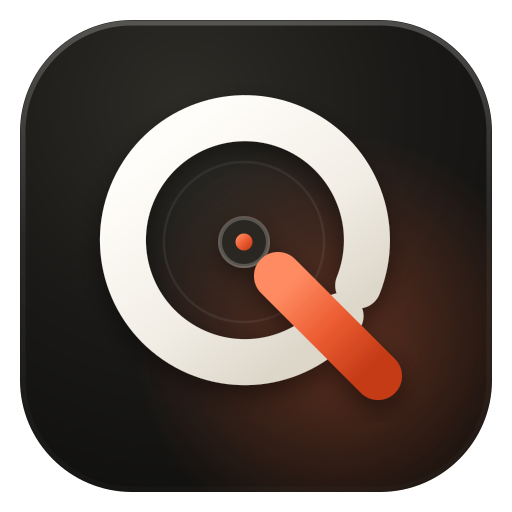
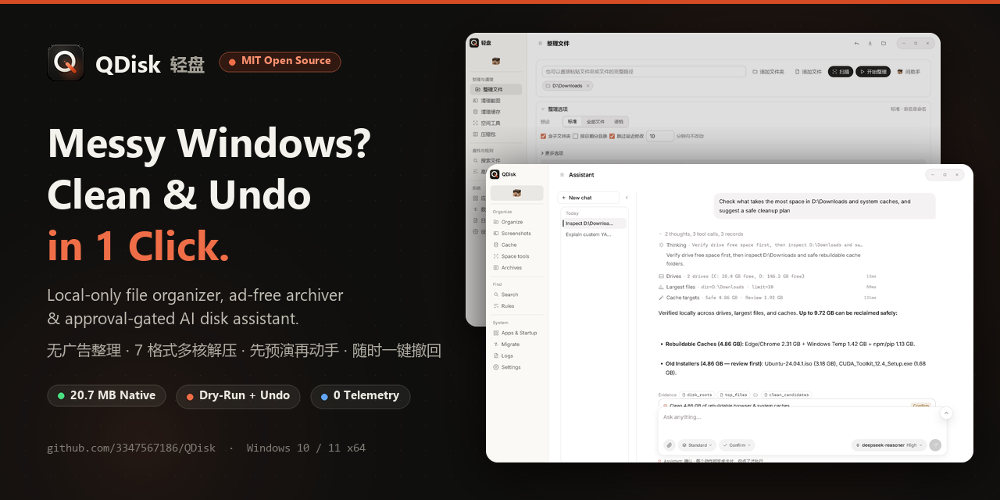
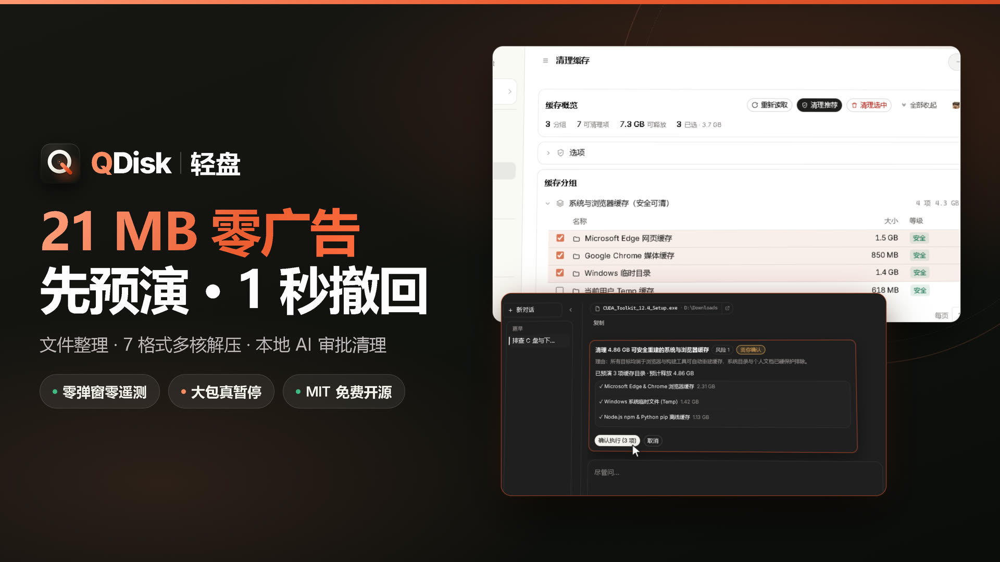
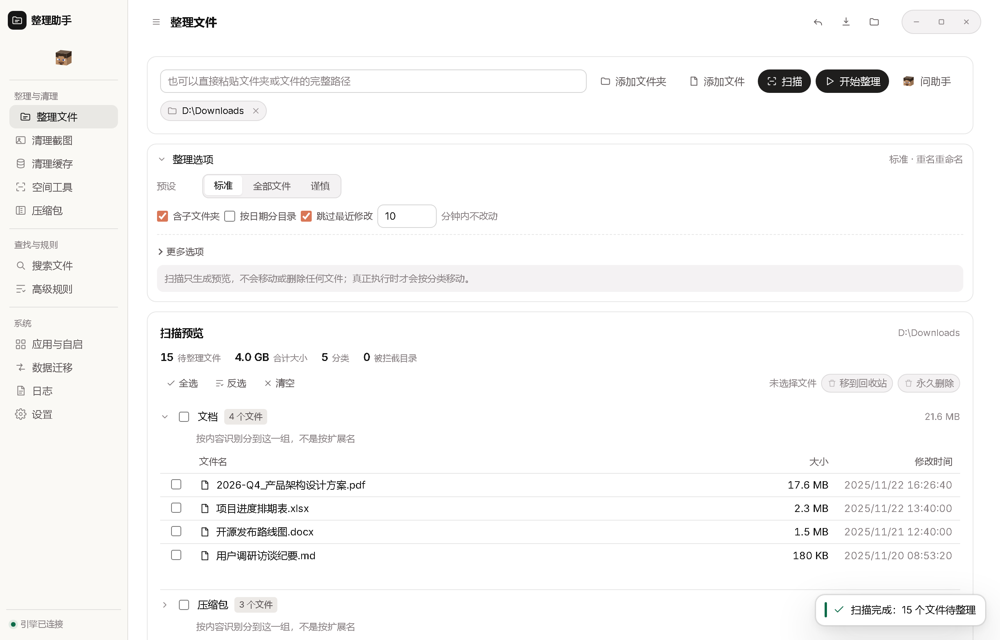
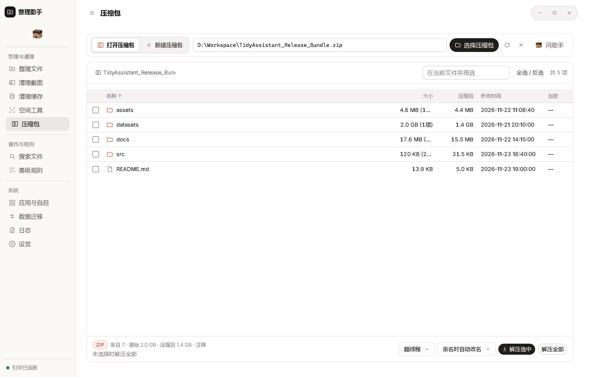
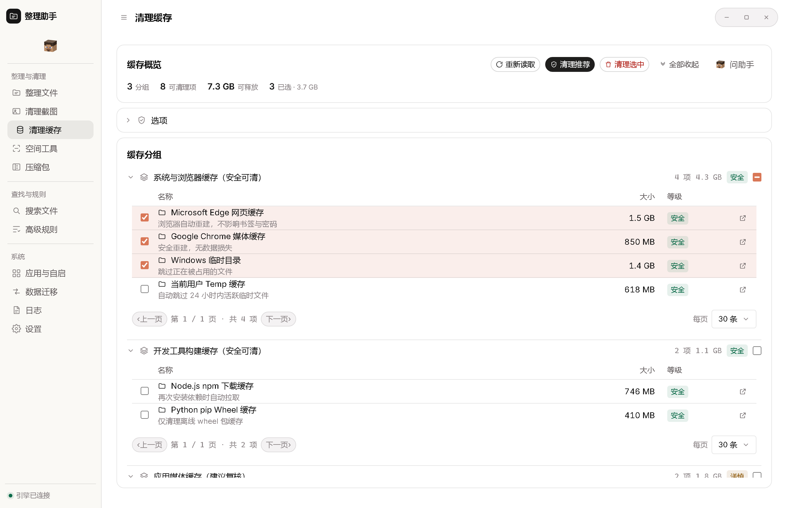
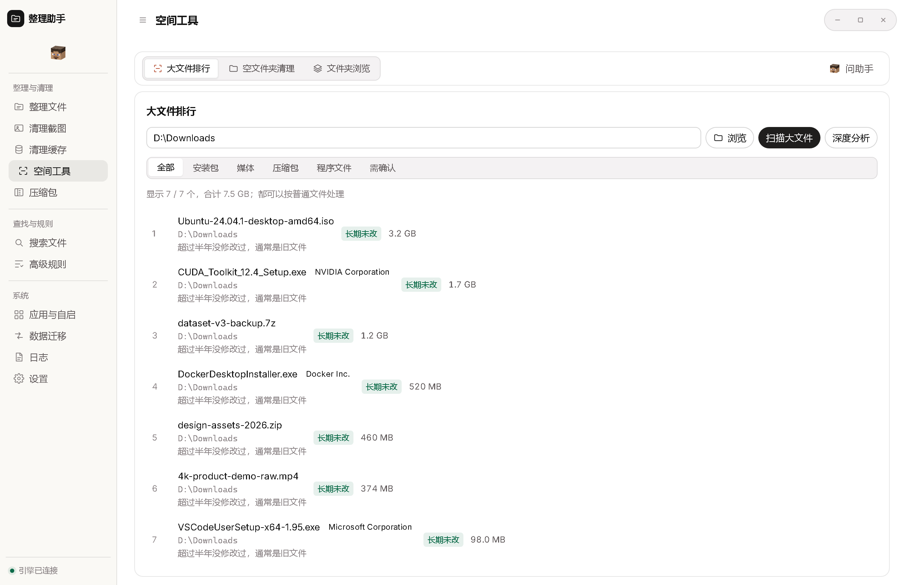

<div align="center">



# 轻盘 · QDisk

**受够了 C 盘天天爆红、下载目录乱成一团、解压软件弹窗满天飞？**  
**我给自己写了一个 20.7 MB、零广告、全本地运行的 Windows 整理与清理工具——每一步删改都能先预演，后悔了 1 秒全撤回。**

[](https://3347567186.github.io/QDisk/)
[-161614?style=for-the-badge)](https://github.com/3347567186/QDisk/releases/latest)
[](https://github.com/3347567186/QDisk/discussions)

[](https://github.com/3347567186/QDisk/releases/latest)
[](https://github.com/3347567186/QDisk/stargazers)
[](LICENSE)
[](#三30-秒下载与使用)

**简体中文** | [English](README.en.md)

<br />

<a href="https://3347567186.github.io/QDisk/">
  
</a>

</div>

---

## 🎬 56 秒官方实机宣传片

<!-- 如需在 GitHub README 原地原生播放，将生成的 <9.5 MB qdisk-promo-github-10mb.mp4 拖入任意 GitHub Issue 编辑框，把返回的 https://github.com/user-attachments/assets/... 链接单行贴到此处即可 -->
<div align="center">
  <a href="https://3347567186.github.io/QDisk/#film">
    
  </a>
  <p><sub>▶ <a href="https://3347567186.github.io/QDisk/#film"><strong>前往官网影幕播放 1080p 有声实机宣传片（0:56 · 支持章节跳播）</strong></a> · 或直接下载 <a href="https://github.com/3347567186/QDisk/releases/download/v1.46.2/qdisk-promo.mp4">MP4 高清原片 (8.5 MB)</a></sub></p>
</div>

---

## 一、它能帮你解决哪 4 件最烦人的事？

> 想按功能逐项互动体验？可直接前往 **[官方网站交互演示](https://3347567186.github.io/QDisk/)**（支持每张界面大图无缝放大查看）或先看下方真实运行截图。

### 1. 下载目录塞满几百个杂乱文件——2 秒归类，点错了 1.39 秒全撤回

- **先看结果再动手**：点「扫描」先列出每个文件将被分到哪里、为什么跳过（底层自动保护代码仓库、系统目录和下载中的临时文件），一个字节都不会提前乱动。
- **不怕手抖**：1,000 个杂乱文件实测 `1.79 s` 分类完毕，不满意点一下撤销，`1.39 s` 全部原路还原；也支持用自然语言让 AI 帮你写自定义 YAML 规则。



### 2. C 盘动不动爆红，却不敢乱删——让本地 AI 查清楚，你拍板才动手

- **不瞎编、不越权**：问一句“帮我查一下 C 盘和下载目录谁最占空间”，AI 会直接调用本机扫描工具核对真实体积，工具名、参数、毫秒耗时全透明可展开；涉及删除或清理一律变成**审批勾选卡片**，你不点确认绝不落盘。
- **点哪去哪，绝不误跑 `.exe`**：点击结果里的任何文件或目录链接，默认在软件内定位高亮（旁边同时保留一键打开系统文件管理器按钮）；遇到 `WindowsApps` 等权限受限目录，支持一键以管理员身份重启并自动续跳定位；对话卡顿点停止 `0.31 ms` 立即真断连，不白烧 Token。


### 3. 受够解压软件弹窗广告、卡死不动——无广告多核压缩包，真能随时暂停

- 原生支持 **ZIP / 7Z / RAR / TAR / TAR.GZ / BZ2 / XZ** 浏览、内置预览、解压与创建，无广告无捆绑。
- **按电脑核数四档调速**：开大包随时分块级**真暂停 / 取消**；解压撞名时可选「直接覆盖」或「二者并存（自动改名）」，内置单槽撤回恢复被覆盖旧文件，并硬拦截路径穿越与压缩炸弹。



### 4. 想安全腾出几十 GB 空间——分层清缓存 + 大文件验厂商 + 无损跨盘搬家

| 安全 / 谨慎分层清缓存（绝不误碰聊天记录与个人文档） | 大文件排行 + Authenticode 数字签名识别厂商 |
|---|---|
|  |  |

- **只自动勾可安全重建的缓存**（浏览器/系统/构建缓存），硬闸门锁死系统目录、`.git` / `.ssh` 与个人文档。
- **跨盘迁移有事务兜底**：预演剩余空间 → 复制 → 哈希校验 → 事务日志 → 原子替换，平时零管理员权限运行，只在操作受保护目录时按需提权。

---

## 二、为什么不直接用现成的清理/解压全家桶？

| 对比维度 | 常见免费清理 / 解压全家桶 | 自己手搓命令行 / 拼多个工具 | 轻盘 QDisk |
|---|---|---|---|
| **广告、弹窗与隐私** | 常带开机弹窗、推荐下载或数据上报 | 干净，但学习门槛高 | **零广告、零遥测、全部数据留在本机** |
| **误删与误操作兜底** | 清理完往往找不回 | 写错命令直接不可逆 | **高危动作先预演，支持一键原路撤回** |
| **大包解压与冲突** | 常缺真暂停，覆盖易丢旧文件 | 缺可视化预览与冲突策略 | **7 格式四档多核、分块真暂停、撞名可并存可撤回** |
| **AI 排查 C 盘安全度** | 无，或直接盲删 | 自己写脚本排查慢 | **工具实测反幻觉 + 勾选审批卡 + 软件内安全定位** |
| **体积与部署成本** | 动辄 150 MB+ 且带后台常驻服务 | 分散维护多个工具 | **安装包 20.7 MB / 便携版解压即用 / MIT 开源** |

---

## 三、30 秒下载与使用

- **🌐 官方网站**：https://3347567186.github.io/QDisk/
- **⬇️ 安装版（推荐，约 20.7 MB）**：前往 **[GitHub Releases 最新版](https://github.com/3347567186/QDisk/releases/latest)** 下载 `QDisk_*_x64-setup.exe`
- **📦 便携免安装版（约 25.1 MB）**：同页面下载 `QDisk_*_x64-portable.zip`（解压到纯英文路径，双击 `tidy-assistant.exe` 即用）
- **🔐 校验与更新**：每个版本均附带 `SHA256SUMS.txt`；软件内置官方 GitHub Releases 自动更新，下载前强制核验 SHA-256，便携版升级失败自动回滚。

> 支持 **Windows 10 / 11 (x64)**。个人配置、规则与撤回日志独立保存在 `%LOCALAPPDATA%\整理助手数据`，卸载或更换版本不丢记录。

💬 **欢迎来 [GitHub Discussions](https://github.com/3347567186/QDisk/discussions) 挑刺**：你平时最怕 Windows 清理或整理工具误删哪类目录？评论告诉我，我会直接加进底层硬保护白名单！

---

## 四、给极客与贡献者（实测数据 / 技术架构 / 二次开发）

<details>
<summary><strong>📊 点击展开：本机真实性能跑分（无估算，含 0.31 ms 真停止 / 304.3 MB/s 多核压缩 / 370+ 项自动化门禁）</strong></summary>

> **测试环境**：AMD Ryzen 9 5900HX（8 核 16 线程）· Windows 11 x64 · NVMe SSD · 轻盘 QDisk（全部为本机运行实采数据）。

| 实测场景 | 测试样本与条件 | 实测结果 | 说明 |
|---|---|---|---|
| **AI 对话阻塞真停止** (`ai_cancel`) | 本地 `TcpListener` 模拟挂起 `WinHttpReceiveResponse`（5 次实测） | **中位数 `0.31 ms`**（239–323 µs） | 跨线程直关 WinHTTP 句柄，告别 60–300 s 超时卡死 |
| **1,000 文件整理预演 / 执行 / 撤回** | 1,000 个混合下载文件（10 扩展名，5 大分类） | 扫描 **`306.5 ms`** · 移动 **`1.79 s`** · 撤回 **`1.39 s`** | `1000/1000` 精准移动与原路还原，失败 0 |
| **10,001 文件索引与模糊检索** | 50 子目录 × 200 文件 + 目标 PDF（30 次 FTS5 查询） | 建库 **`68.4 ms`**（~14.6 万文件/秒）· 检索中位数 **`6.53 ms`** | Rust `indexwalk` + SQLite FTS5，P95 延迟 `7.23 ms` |
| **引擎冷启动 & JSON-RPC 往返** | `tidy.py --engine` 冷启 + 20 次热态 `ping` | 冷启含首包 **`224.4 ms`** · 热态往返 **`0.10 ms`** | 长驻引擎零重复冷启开销 |
| **产物与前端体积** | 正式 Release 产物 | 主壳 **`5.56 MB`** · 安装包 **`20.7 MB`** · 便携包 **`25.1 MB`** | 零框架前端总源码约 `2.0 MB`（0 `node_modules`） |
| **全栈自动化测试门禁** | `build.ps1` 每次发包强制执行 | **370+ 项测试全绿** · Release **`0` 警告** | Python 237 项 + Rust 62 项 + JS/官网 8 套自动化红队回归 |

#### Rust 多核压缩内核四档动态性能实测（64 MB 混合集：75% JSON + 25% PNG，32 文件）

| 性能档位 | 动态分配线程 (16T) | CPU / I/O 占空比 | 压缩耗时 & 速率 | 相对节约档提速 | 解压吞吐（含系统页缓存） |
|---|---|---|---|---|---|
| **节约 (`saver`)** | `1` 线程 | `35% / 25%` | `3,025.6 ms` · **`21.2 MB/s`** | `1.0×` | `852.6 MB/s` |
| **平衡 (`balanced`)** | `6` 线程 | `65% / 50%` | `696.3 ms` · **`91.9 MB/s`** | **`4.3×`** | `2,998.6 MB/s` |
| **高性能 (`performance`)** | `10` 线程 | `85% / 75%` | `210.3 ms` · **`304.3 MB/s`** | **`14.4×`** | **`3,844.1 MB/s`** |
| **超线程 (`hyper`)** | `16` 线程 | `100% / 100%` | `235.1 ms` · **`272.3 MB/s`** \* | **`12.8×`** | `2,661.5 MB/s` |

> \* 64 MB 短任务中 16 线程建池开销略高于 10 线程；GB 级大体积归档下 `hyper` 档零节流吃满全部逻辑核优势更显著。

</details>

<details>
<summary><strong>🧱 点击展开：技术栈、本地编译运行与 4 大免改核心扩展接口</strong></summary>

#### 自研核心 vs 开源组件

| 分类 | 核心内容 |
|---|---|
| **核心自研** | **Rust 并发压缩内核**（`archive/`：4 档 `WorkPacer`、分块暂停取消、防逃逸、单槽撤回、`ArchiveCodec`）；**零新增依赖在线更新引擎**（`updater.rs`：安装/便携双形态、仓库锁仓、失败自动回滚）；**0.31 ms WinHTTP 真断连网关** & **原生路径探测定位**（`main.rs`）；**本地 AI Agent 与四档审批闸门**（`web/js/ai/`）；**零框架 12 页桌面 UI**；**Python 事务整理/迁移引擎 + Rust 遍历器 `indexwalk`** |
| **开源组件** | **Tauri v2** + `tauri-plugin-single-instance`、**Rust Crates**（`windows-sys`, `zip`, `sevenz-rust2`, `lzma-rust2`, `flate2`/`zlib-rs`, `bzip2`, `tar`, `sha2`, `walkdir`, `rfd`, `libloading`）、**Python 3.11 + SQLite FTS5**、按需官方下载并双校 SHA-256 的 `UnRAR64.dll`（详见 [THIRD_PARTY.md](THIRD_PARTY.md)） |

#### 环境要求与本地命令

需 Windows x64 + Rust 1.80+ + Python 3.11+ + Node.js 20+ + PowerShell 7 (`pwsh`) + NSIS 3.x：

```powershell
git clone https://github.com/3347567186/QDisk.git && cd QDisk

# 前端与官网离线自测（零构建步骤，改完即测）
node src/web/js/ai/md.selftest.mjs
node src/web/js/ai/pages.selftest.mjs
node src/web/js/ai/website.selftest.mjs

# Python 引擎单测（237 项） & Rust 核心单测（62 项）
python -m unittest discover -s src/engine -p "test_*.py" -v
cargo test --release --manifest-path src/src-tauri/Cargo.toml

# 全量测试门禁 + 编译打包安装包、便携包与 latest.json
pwsh -NoProfile -ExecutionPolicy Bypass -File .\build.ps1 -Bump patch
```

#### 四层标准扩展点（免改核心代码）

| 扩展层 | 入口文件 | 注册方式 |
|---|---|---|
| **前端新页面 & 钩子** | `src/web/js/app.js` | `App.registerPage(id, { zh, en, icon, mount })` / `App.onHook(event, fn)` |
| **AI 助手新动作** | `src/web/js/ai/registry.js` | `AIRegistry.register(name, { label, risk, schema, run })`（自动接入审批闸门） |
| **Python 引擎新 RPC** | `src/engine/tidy.py` | `tidy.register_engine_method("custom.op", handler, meta={...})` |
| **Rust 压缩新格式** | `src/src-tauri/src/archive/registry.rs` | 实现 `ArchiveCodec` trait 并注册，自动通过 `archive_capabilities` 暴露 |

私有化/内网发包说明见 [发包与在线更新指南](docs/01-当前版/发包与在线更新指南.md)。

</details>

---

欢迎提交 [Issue](https://github.com/3347567186/QDisk/issues)、参与 [Discussions](https://github.com/3347567186/QDisk/discussions) 或 PR · 本项目基于 **[MIT License](LICENSE)** 开源。

---

## ☕ 请作者喝杯咖啡

> 独立开发与持续维护不易，如果 **轻盘 QDisk** 帮你省下了时间和磁盘空间，欢迎请作者喝杯咖啡。  
> 你的每一份支持都会化作持续优化与打磨软件的动力，谢谢支持！

<div align="center">
  <table>
    <tr>
      <td align="center" width="260">
        <br />
        <sub><strong>微信支付 · 扫一扫赞赏</strong></sub>
      </td>
      <td align="center" width="260">
        <br />
        <sub><strong>支付宝 · 扫一扫赞赏</strong></sub>
      </td>
    </tr>
  </table>
  <p><sub>软件永久免费开源、零广告零捆绑 · 随心支持，点一颗 ⭐ Star 同样是莫大的鼓励</sub></p>
</div>
